## The Origin of the Problem

How can the data of a qualitative study with hundreds of sources, dozens of concepts and complex relations among them be organized rigorously and replicably?

That question followed the same researcher for more than a decade — and each attempt to answer it became a step in building what is today the Synesis language.

The language was formally born in 2026, but its history did not begin that year. Its architecture, domain vocabulary and methodological requirements result from a path started decades earlier, along which two lines of experience advanced until they converged: the practice of software development and qualitative research. BDM, SocioAtlas, the socio-environmental diagnosis pipeline, SocioAtlas for Google Sheets and DGT7 were not disconnected projects but successive implementations of one same effort. Each solved part of the problem, revealed new limits and left conceptual or technical components that would be incorporated into Synesis.

## Timeline {#sec-linha-do-tempo}

### 1986 — First contact with programming

Christian Maciel De Britto began studying computing at 13. At the New York Institute in Belo Horizonte, Brazil, he took the Basic I and II courses and had his first contact with **Basic** and notions of **COBOL** — a language organized in blocks with explicit start and end delimiters. Decades later, that way of structuring instructions would find its counterpart in Synesis syntax: `SOURCE ... END SOURCE`, `ITEM ... END ITEM`.

### 1991–1999 — ImageWare Informática: the first commercial software of his own

The discovery of **dBase II Plus** and **Clipper** (Autumn 86, Summer 87 and Clipper 5) opened the professional path and, in 1991, led to the founding of **ImageWare Informática Ltda.**, a company of which Christian was founder and CEO. In Clipper — a language oriented to data and records — two proprietary software products, owned by the company, were developed and sold:

- **SALA** — a school management system for academic data, grades and transcripts;
- **SAGA — Fuel Station Automation System**, which reached more than a hundred active customers.

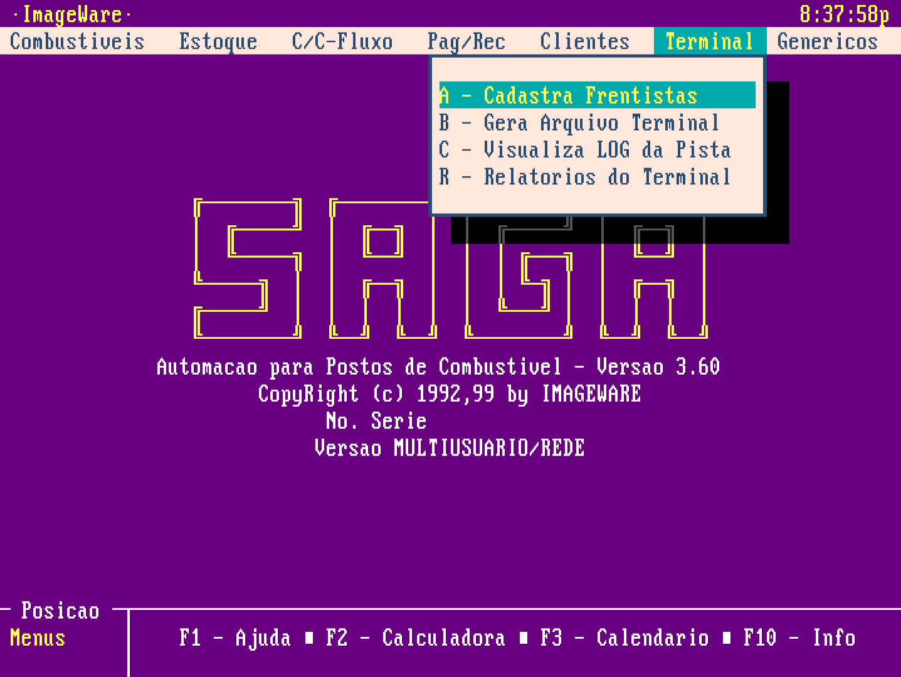

The Clipper (xBase) programming environment and the MS-DOS operating system played an important role in this intellectual and professional formation. [This article presents the historical context of that technology](https://www.linkedin.com/pulse/o-rei-do-dos-hist%C3%B3ria-completa-de-como-clipper-e-perdeu-brandini-bqbff/) (in Portuguese).

Between 1995 and 1997, ImageWare was incubated at InsoftBH, an incubator for technology-based software companies in Belo Horizonte, Minas Gerais, with support from the Software Society of Minas Gerais — [FUMSOFT](https://fumsoft.org.br/) — and the Federal University of Minas Gerais (UFMG). In this period Christian also took the course *Software product quality: standards NBR ISO 13.596 and ISO/IEC 12.119*, taught by Márcia Silveira de Almeida, MSc (UFMG).

This stage consolidated an experience that would reappear in Synesis: conceiving, developing and selling one's own software — with clear intellectual ownership of the products —, modelling real domains, organizing structured data and treating software quality as a requirement of systems used by other people.

### 1999 — A change of direction

ImageWare's commercial activity ended in 1999, and the focus turned to a Christian walk, involving theological study and practice. The encounter with Jesus Christ! A conversion. This spiritual, intellectual and professional realignment fed a hermeneutical, epistemological and philosophical sensibility that would later find expression in applying the philosophies of Herman Dooyeweerd and Dirk Vollenhoven, Dutch Christian philosophers, to research method. At the same time, a financial control system in **Delphi 5**, developed without commercial purpose, kept the link with programming practice alive.

This phase brought together two dimensions that would become inseparable in Synesis: rigorous interpretation of texts and concepts, and the construction of computational instruments able to organize them.

### 2011–2013 — BDM: the first prototype

In the master's dissertation [*Sustainability and Intradisciplinarity*](https://doi.org/10.13140/RG.2.2.10686.10563) (UFPR), devoted to the socio-environmental impacts of the oil-related industry in Pontal do Paraná, **BDM — Multimodal Database** appears.

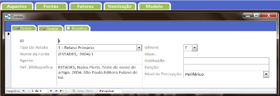

Technically simple — a **Microsoft Access 2010** front end connected to **PostgreSQL** —, BDM was a local, individual solution. Its workflow, however, already held the embryo of what would come: **sources** classified by type, **factors** linked to philosophical modalities, **items** related to pairs of factors with positive or negative links, and automatic generation of summaries and relation graphs.

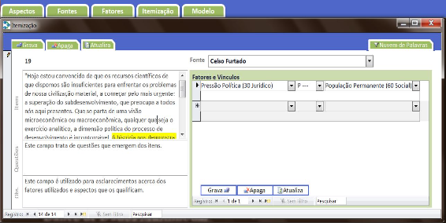

The author himself recognized an important limitation: BDM allowed only pairs of factors per item. The question left open — how to represent richer networks of relations without losing rigour? — shaped everything that came after.

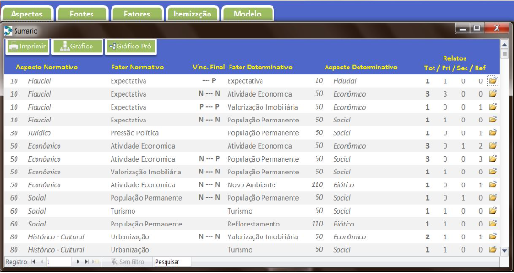

Still in embryonic form, BDM organized knowledge in "blocks" of sources, items and ontology. In the end it generated an analytical model as a knowledge graph, using the [GraphViz library](https://graphviz.org/).

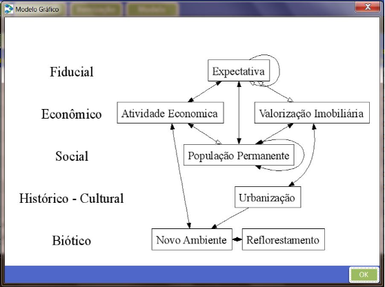

BDM's legacy to Synesis was the first operational definition of its domain: sources, items, factors, relations, ontology and knowledge graph came to form an integrated structure.

### 2018 — SocioAtlas: a custom CAQDAS ecosystem

In the doctoral thesis [*Multimodal Systemic Thinking*](https://doi.org/10.13140/RG.2.2.26449.17760) (UFPR), the answer was more ambitious: **SocioAtlas**, an ecosystem whose parts were developed in **Free Pascal/Lazarus**, with a **Firebird** database.

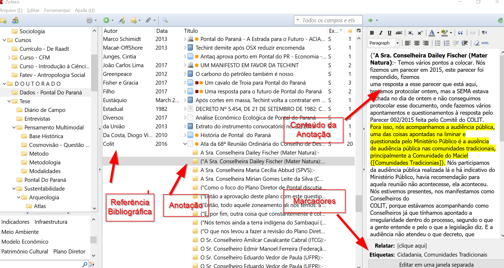

The solution was a CAQDAS (*Computer-Assisted Qualitative Data Analysis Software*) built to measure for the Multimodal Systemic Method (MSM). It imported data from **Zotero**, organized sources, items and factors, linked each factor to a modality and included a georeferencing layer exporting KML files to Google Earth Desktop. The *SocioAtlas* web platform made the maps publicly accessible.

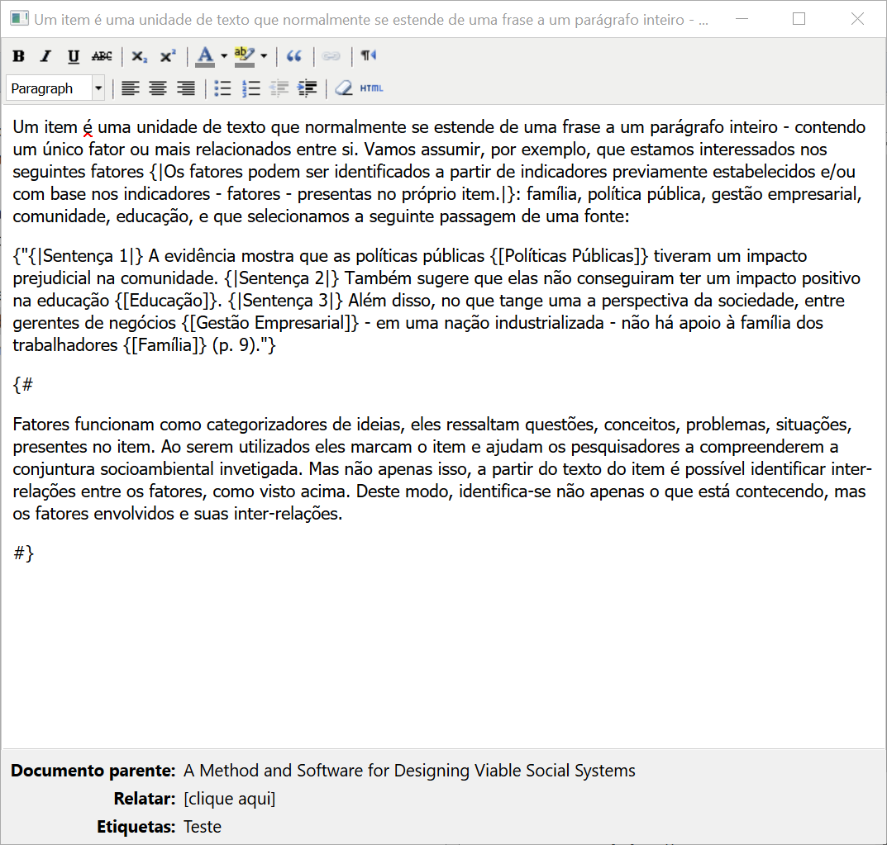

In Zotero, concepts, comments and analytical memos were identified by a marker system created for the solution. Thus a concept such as `{[Public Policy]}` could be distinguished from an analytical comment such as `{#an analytical comment#}`. These were the markings adopted:

```
{[ ]} - Highlight for concepts
{! !} - Audit trails and analytical memos
{" "} - Quotations
{# #} - General comments
```

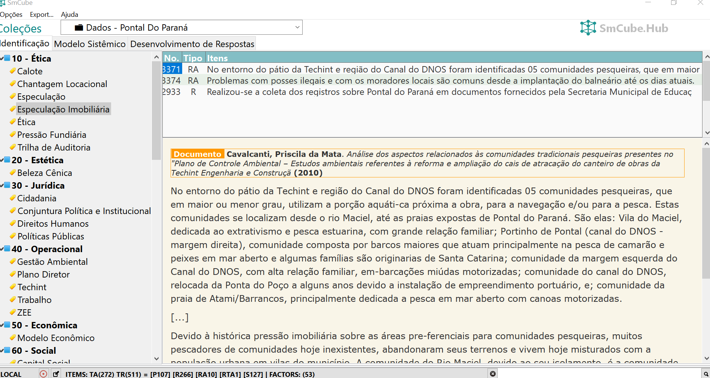

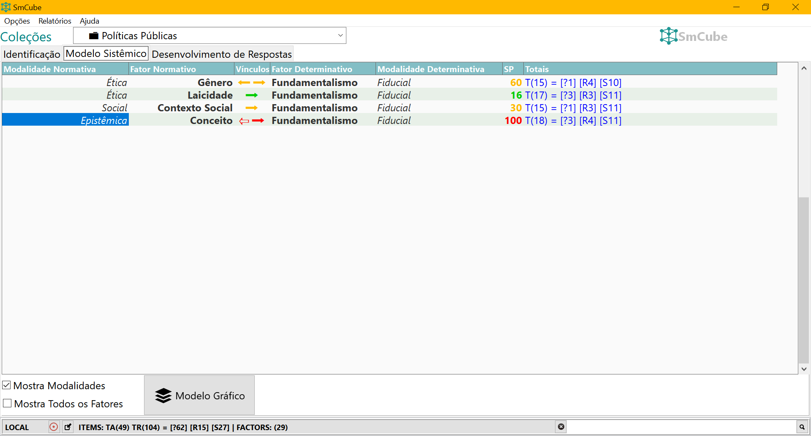

Compared with BDM there was an important innovation: the possibility of incorporating georeferenced data. Hence the name SocioAtlas.

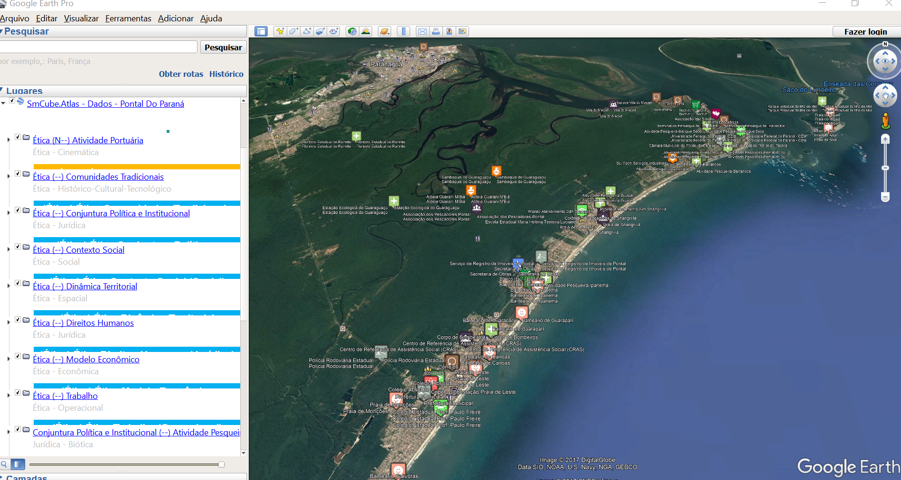

Several components that would reappear in Synesis were already present: source, item, factor, audit trail, Zotero integration and graphical representation of knowledge. What was missing was **methodological portability** — the structure was coupled to MSM and its eighteen modalities. Adapting the system to a different study required rewriting the software.

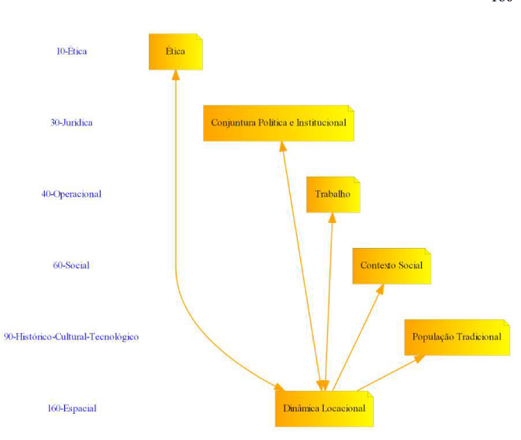

SocioAtlas broadened the domain begun in BDM and showed that a research environment needed to integrate annotations, concepts, auditing, ontology, geographic location and visualization. Its limitation revealed the next decisive requirement of Synesis: allowing the method to be configured without reprogramming the tool.

### 2019–2020 — Socio-environmental diagnosis: the first pipeline in a professional setting

Between 2019 and 2020, working as a sociologist in an environmental consultancy, came the first opportunity to apply the principles developed in the earlier stages to a real professional setting: a participatory socio-environmental diagnosis of fishing communities, conducted in compliance with Brazilian federal environmental licensing rules.

The challenge was methodologically rich and operationally demanding. Field teams collected data through semi-structured interviews with residents and leaders, direct observation and participatory workshops. The volume of material produced — transcripts, descriptions, observation forms — had to be turned into structured analysis, comparable between communities and auditable.

For this, a **Microsoft Word add-in** was developed in **Visual Basic for Applications (VBA)**. The researcher selected passages of the transcripts directly in the document and applied markers identifying the significance value of the passage (0, 0.5 or 1, corresponding to null/low, moderate or high impact) and its category in the **SWOT matrix** — strength, weakness, opportunity or threat. The add-in read these markings and exported the structured data to a spreadsheet, where they were counted by community, theme and dimension of sustainability.

The complete pipeline comprised three layers: **itemization** — extracting individual text segments, each containing a single idea — followed by **thematic coding** with assignment of SWOT categories and significance points, and finally **visualization** of the consolidated data in dashboards built in **Power BI**, which allowed filtering by community, dimension of sustainability (physical and biotic, sociocultural, economic, infrastructure and services), Sustainable Development Goals (SDGs) and SWOT category.

The result was a **local sustainability scale** computed for each community, geographically comparable through an interactive map — and fully traceable back to the original items, which in turn pointed to the complete textual corpus of the technical and community readings.

What this work brought to the Synesis path was validation at professional scale of two principles already present in BDM and SocioAtlas: the **audit trail** — the verifiable chain corpus → item → summary → theme → score — and the need for any invalid marking to raise an immediate error, not silence. A theme code mistyped in Word created a duplicate factor without warning, exactly the same problem DGT7 would repeat years later and that the Synesis compiler would definitively solve with *compile-time* validation. The experience also showed that methodological portability was a real requirement, not a theoretical one: the same pipeline had to be adapted to multiple thematic domains and distinct community contexts, each with its own configuration of themes and categories.

### 2023 — SocioAtlas for Google Sheets

Both the original SocioAtlas and the diagnosis pipeline shared a limitation: they depended on locally installed software or specific professional environments. Why not rebuild the essence of the method on a platform accessible to any researcher, anywhere? **SocioAtlas for Google Sheets** — a **Google Apps Script** add-on published on the Google Workspace Marketplace — turned an ordinary spreadsheet into a knowledge base. The researcher marked passages in Google Docs, and the system imported and organized the data and generated multimodal analysis matrices automatically. The link to that old version is still [available here](https://workspace.google.com/marketplace/app/socioatlas/113414702386), as is the site with [the documentation](https://www.socioatlas.xyz/).

Annotations were made in Google Docs, where items were highlighted and commented, while concepts were identified through tags.


SocioAtlas read the analyzed documents and imported the data into a Google Sheets spreadsheet, where analysis and knowledge graph generation took place.


Team collaboration was achieved. Depth was not. A spreadsheet is a tabular environment, designed for data in rows and columns. Nested annotations, typed relations and concept hierarchies caused constant friction. Each new methodological requirement demanded fragile solutions. A research tool could not depend on such failure-prone adaptations.

This implementation proved the value of collaboration and accessibility, but also showed that tabular interfaces were not enough to represent complex knowledge structures. Synesis would inherit the pursuit of portability and shareable work, replacing the spreadsheet with a structured textual representation.

### 2025 — The DGT7 pipeline: a proprietary format for knowledge representation

To analyze 453 articles on the social acceptance of technologies in the context of the energy transition, a new pipeline was created in **Python**, with a **MySQL** database and its own markup language. The marker system created for SocioAtlas reappeared in this solution, now as the basis of a textual representation of knowledge:

```
[-begin-]
[@burke2018@]
[!Distributed energy systems allow structures of
political power to be reorganized.!]
[%Distributed energy may restructure political power%]
[#Energy System#][&influences&][#Governance#]
[-end-]
```

The system worked, but was hard to read and fragile against typing errors — `[#Energy Sistem#]`, for instance, created a duplicate factor without warning. Moreover, any change in methodology or fields required rewriting scripts, database and web platform. The format remained tied to one specific research model.

DGT7 was one more instance of the conceptual pattern under construction since BDM — sources, items, typed relations, ontology, traceability — applied to a specific corpus. It showed that knowledge could be recorded in text files, but also that a simple markup convention did not offer enough readability, validation or methodological flexibility. The remaining question was the same one open since 2013: how to generalize this pattern to any research, without reprogramming the tool for each new domain?

### 2026 — The formal birth of the Synesis language

The first attempt to overcome the limitations of the DGT7 pipeline, so as to serve the demands of any kind of qualitative research, was modest: writing a more robust parser for that format. Yet in defining clear rules for writing the files, a new possibility arose — and a more ambitious question: instead of patching a proprietary markup, why not create a real language?

The central innovation was to separate **method** from **content**. In earlier systems, fields were embedded in scripts and database. In Synesis, a **template file** defines which fields exist, which are required and what their types are. The researcher configures the rules of their own research, and the system adapts.

The same passage came to be expressed in the new language like this:

```synesis
SOURCE @burke2018
    description: Explores renewable energy and political power
END SOURCE

ITEM @burke2018
    citation: "Distributed energy systems allow structures
               of political power to be reorganized."
    note: Distributed energy may restructure political power
    code: Energy_System -> INFLUENCES -> Governance
END ITEM
```

The file remains readable by a person. At the same time, if the researcher writes `Governance` without defining it in the ontology, stored in a file of a specific format, the compiler issues an immediate warning. There is no silent ambiguity: either the concept exists in the declared ontology, or the compiler points out its absence at the origin (and, with the `--strict` option, refuses the compilation).

By becoming a formal language with an LALR(1) grammar, Synesis came to offer what none of the earlier scripts could ensure on their own: real-time validation in the editor, automatic field completion, export to JSON, CSV and Excel and portability to different kinds of qualitative research.

Methodological portability was confirmed almost immediately. The doctoral thesis *Administrar pela Graça: a contribuição da fé cristã para uma responsabilidade sacrificial corporativa (RSaC)* (Managing by Grace: the contribution of Christian faith to a sacrificial corporate responsibility), defended by Davi P. A. Brescia at UFMG in 2026 in the field of Management Sciences, adopted Synesis to process a corpus of 50 interviews — about 800 thousand words — with more than 10 thousand first-order concepts annotated, attesting the breadth of the language's scope of application. To make large-scale application feasible, components that did not exist were developed: the LSP server, the VS Code extension and the integration with Claude via MCP, tested first-hand. The agreement between the coding automated by the compiler and the human reference coding exceeded 95%. This was the first demonstration, in an independent doctoral setting, that Synesis worked as a general-purpose methodological tool — not as a specific solution for one theme or research group.

The formal birth of Synesis in 2026 was therefore the point of convergence of a much longer construction. What began as a local database grew into a research ecosystem, moved to a collaborative platform, was converted into textual markup and was finally formalized as a language with its own grammar, compiler, language server and integration with the environments where researchers already work.

## Two Paths, One Point of Convergence

Synesis is where two paths meet: decades of software development practice — Basic, COBOL, Clipper, Delphi and Python — and decades of immersion in hermeneutics, epistemology, philosophy and qualitative research methodology — BDM, SocioAtlas, the socio-environmental diagnosis pipeline, SocioAtlas for Google Sheets and DGT7.

Each stage left an identifiable contribution. COBOL's block language offered an early reference for structure. Clipper's data orientation and experience with real systems formed the practical base of domain modelling and software quality. BDM defined sources, items, factors, relations and ontologies as parts of one flow. SocioAtlas integrated annotations, audit trails, Zotero, georeferenced data and graphs. The socio-environmental diagnosis pipeline validated, in a real professional setting, the audit trail corpus → item → summary → theme → score and showed that the lack of validation at data entry produced silent errors — the same problem Synesis would solve with compilation. The Google Sheets version introduced collaboration and accessibility while revealing the limits of spreadsheets. The DGT7 pipeline took knowledge into text files and exposed the need for a formal, readable and validatable syntax.

The use of AI entered this path as an implementation partnership, not as a replacement for domain knowledge. The methodological requirements, the conceptual vocabulary and the fundamental architecture decisions were born from the experience accumulated in earlier implementations. AI made it possible to translate that repertoire into a software ecosystem at exceptional scale and pace — by the traditional route of individual development, the same result would have taken years.

The preceding stages took place in different contexts — academic research, own business activity, professional consulting —, each with its specific ties and institutional regimes. The Synesis ecosystem in its current form — compiler, LSP server, VS Code extension, graph pipeline, Zotero plugin and documentation — was developed independently of those stages: entirely with AI-assisted coding, using exclusively the author's own resources, with no tie to institutional projects, laboratories or funding. The experience accumulated in earlier stages defined *what* to build and *why* to build it; AI accelerated the technical execution.


The [author's full curriculum](https://lattes.cnpq.br/2334832147379385) is available on the Lattes platform.

[ORCID](https://orcid.org/0000-0003-1431-3924)

Dr. Christian Maciel De Britto


Soli Deo Gloria
