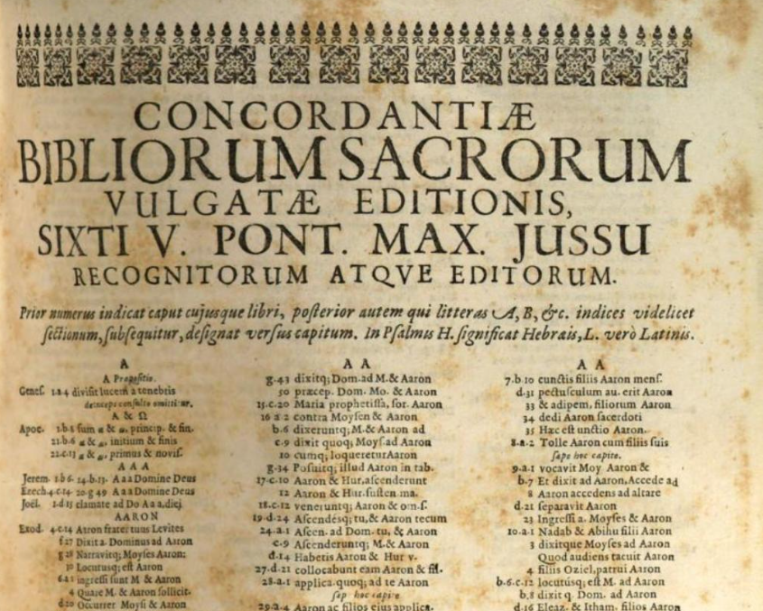
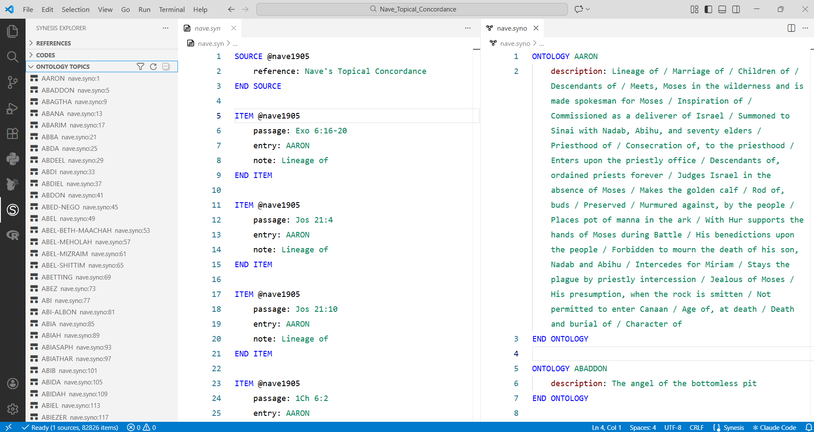
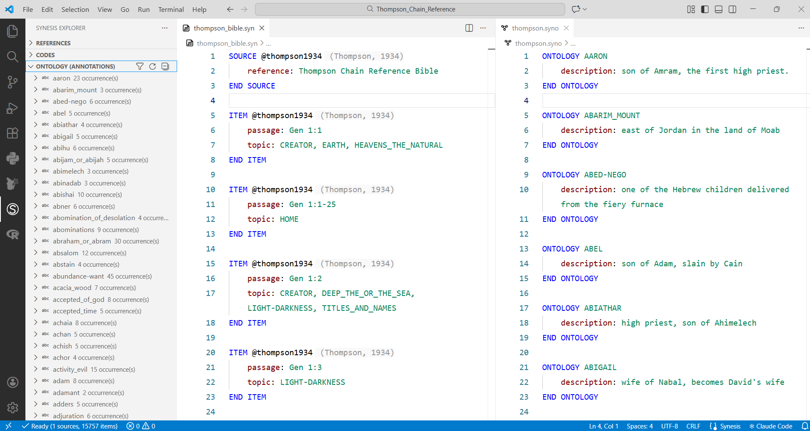

# Synesis and Scripture

The Bible is a remarkable book. Written over more than 1,500 years, by more than 40 authors living on three continents (Asia, Africa and Europe), in three languages (Hebrew, Aramaic and Greek), it is at once diverse and deeply cohesive. A cataloguing effort by Pastor Christoph Römhild identified 63,779 cross references in Scripture, which led to the visualization made by Chris Harrison.


## Why Annotate Scripture Systematically?

Readers of Scripture have long noticed that certain themes recur throughout both Testaments. To navigate this thematic richness, tools were developed such as concordances (listing occurrences of specific terms), cross references (conceptual links between verses, connecting people, events, places and theological concepts) and systematic theology (the discipline that organizes the doctrines of the Christian faith by identifying and grouping relevant passages).

In 1890, Dr. Frank Charles Thompson, for instance, began annotating the margins of his Bible, connecting themes in a chain-reference system — a work that occupied his whole life and remains available today in the Thompson Study Bible.


## What Is Synesis

Synesis is a structured annotation language for qualitative research. It records passages from sources — texts, interviews, documents — attaching to each passage metadata such as themes, concepts and relations. Annotations are stored in a format readable by people and processable by machines, and can be exported to databases, spreadsheets or knowledge graphs.

In the context of Scripture, Synesis works as a programmable concordance: instead of consulting a fixed index, the researcher builds their own reference system, with whatever criteria and categories they wish. The result is an annotated corpus that can be queried, expanded and visualized in ways no manual system offers.

Three features make Synesis particularly suited to systematic Bible study:

* **Scale.** A manual system like Dr. Thompson's took a lifetime to build. With Synesis, the same kind of structure can be developed incrementally, collaboratively and verifiably.
* **Taxonomic flexibility.** Themes and categories are defined by the researcher, with no controlled vocabulary imposed from outside. One may work with the categories of classical systematic theology, with one's own structures, or both at once.
* **Interoperability.** Annotations can be exported to several formats and integrated with other analysis, visualization and research tools.


### How to Replicate the Thompson System in Synesis

Dr. Thompson's annotation system can be represented directly in Synesis. The themes field records several keywords per item, separated by commas, working as the thematic links of chain references.

```synesis
SOURCE @thompson1999
    description: Thompson study Bible with chain references
END SOURCE

ITEM @thompson1999
    passage: Pr 12.23
    quote: "A prudent man concealeth knowledge: but the heart of fools proclaimeth foolishness."
    themes: Prudence, Folly
END ITEM

ITEM @thompson1999
    passage: Pr 14.15
    quote: "The simple believeth every word: but the prudent man looketh well to his going."
    themes: Credulity, Prudence, Folly
END ITEM

ITEM @thompson1999
    passage: Pr 15.5
    quote: "A fool despiseth his father's instruction: but he that regardeth reproof is prudent."
    themes: Value_of_Reproof, Dishonoring_Parents, Prudence, Foolish_People
END ITEM
```

## A Tradition of Centuries

The need to organize and connect Scripture thematically did not begin with Dr. Thompson. It accompanies the history of Christian hermeneutics from the first centuries, and produced ever more sophisticated instruments over time.

In the third century Origen was already producing the *Hexapla*, a work of textual organization and comparison that presupposed systematic identification of parallels and variants. Jerome, in the fourth century, and the medieval monks who developed the *Concordantiae* — alphabetical indexes of the words of Scripture — continued the tradition. The first complete concordance of the Latin Vulgate is attributed to Hugh of Saint-Cher, in the thirteenth century, produced with the help of hundreds of copyists.



With the Reformation and the spread of vernacular translations, new tools became necessary. In 1550 John Marbeck published the first complete English concordance. But it was in the nineteenth and twentieth centuries that the project of thematically organizing Scripture reached its greatest sophistication:

**Nave's Topical Bible** (1896) — Rev. Orville James Nave spent 23 years compiling this work while serving as a military chaplain. Organized by topic rather than by verse, it lists more than 20,000 themes and subthemes with their passages, over 100,000 references in all.



**Thompson Chain-Reference Bible** (1908) — Dr. Frank Charles Thompson developed a different system: instead of separate works, he integrated the references into the margins of the Bible itself, organized in numbered thematic chains that lead the reader from verse to verse across the whole canon.



What these works share is the problem they try to solve: Scripture forms a dense network of thematic, typological and theological relations that no reader can map entirely from memory. Each system is a manual solution to this problem — and each carries the limits of the medium in which it was built. A printed book cannot be queried by several criteria at once, cannot be updated without a new edition and cannot be integrated with other analysis systems.

Synesis starts exactly here: the tradition has already established that the problem is worth solving. What changes is the medium.

### What to Do with These Annotations

The annotations can be exported to several formats and used for thematic analysis. It is even possible to generate graphical visualizations similar to Chris Harrison's, showing the structure of connections among the annotated passages.

## A Common Problem

Notably, both concordances and modern qualitative coding answer the same epistemological challenge: how to extract patterns from a large, heterogeneous textual corpus while preserving the link between each pattern and its source text.

In both cases the researcher needs to:

* **(1)** read the text,
* **(2)** identify units of meaning,
* **(3)** assign categories to those units, and
* **(4)** later retrieve every passage associated with a category.

The structure of the process is identical.

Qualitative coding and the systematic organization of Scripture share a deep common structure: identifying units of meaning in a textual corpus, assigning categories and retrieving connections.

Synesis does not apply research methods to a new domain — it recognizes a continuity that always existed between these two traditions and offers a formal instrument for both.


# Concordances in Synesis

The [project's case-study repository](https://github.com/synesis-lang/case-studies/tree/main/Theology) holds ready-to-use versions of the **Thompson Chain-Reference Bible** and **Nave's Topical Concordance** in Synesis — two of the most important reference works of Christian hermeneutics, now in an interoperable format that can be queried programmatically. Both works are in the public domain; the original digital versions can be obtained free from [Crosswire.org](https://crosswire.org/sword/modules/ModDisp.jsp?modType=Dictionaries).

## The Potential of Synesis for Theology

The relevant question is not technical — it is about what the format makes it possible to think.

### Convergence of Heterogeneous Sources

Nave's and Thompson were born as parallel projects, by different authors, with different structures, in different decades. In print it was not simple to ask: *on which verses about Faith do Nave's and Thompson agree?* — because the sources sat in separate silos.

In Synesis both works can be adapted to share the same data model. A query like that then becomes trivial.

### The `chain` Field as a Tool for Systematic Theology

Systematic theology works with relations between doctrinal concepts — and Synesis has formal primitives to represent them:

```synesis
SOURCE @systematic_theology2026
    description: "Fundamental doctrinal relations"
END SOURCE

ITEM @systematic_theology2026
    memo: Relation between grace, faith and justification in Pauline soteriology
    chain: Grace -> PRODUCES -> Faith -> PRODUCES -> Justification
END ITEM

ITEM @systematic_theology2026
    memo: Structural tension between the paradigms of Law and Gospel
    chain: Law -> CONTRASTS_WITH -> Gospel
END ITEM
```

Synesis offers a data model that expresses the relational chaining of theological concepts precisely and easily, with open and traceable data.

### Controlled Theological Vocabulary

Ontologies allow a structured theological thesaurus, with hierarchical navigation by area of theology:

```synesis
ONTOLOGY Justification
    description: "Act by which God declares the sinner righteous on the basis of the work of Christ"
    group: Soteriology
END ONTOLOGY

ONTOLOGY Sanctification
    description: "Progressive process of conformity to the image of Christ"
    group: Soteriology
END ONTOLOGY
```

This allows questions Bible indexing systems never offered in structured form: *show all concepts mapped under Soteriology*, or *which Nave's passages deal with concepts of that group?*

### Doctrinal Tensions as Comparable Data

The most significant potential lies in modelling interpretive disagreements. Different theological traditions assign different meanings to the same texts. With Synesis this can be represented explicitly:

```synesis
SOURCE @calvin_institutes
    description: "Institutes of the Christian Religion, John Calvin"
END SOURCE

ITEM @calvin_institutes
    quote: "Jn 6:37 — All that the Father giveth me shall come to me"
    memo: Proof of divine sovereignty in unconditional election
    chain: Divine_Sovereignty -> PRODUCES -> Unconditional_Election
END ITEM

SOURCE @arminius_works
    description: "Complete Works, Jacobus Arminius"
END SOURCE

ITEM @arminius_works
    quote: "Jn 6:37 — All that the Father giveth me shall come to me"
    memo: Election is grounded in divine foreknowledge of future faith
    chain: Divine_Foreknowledge -> PRODUCES -> Conditional_Election
END ITEM
```

The same passage, two theological systems, structured and comparable data.

---

*Synesis does not turn the sacred text into data — it turns the **inspired human work of interpretation** into data. Thompson and Nave are the indexing layer. What is built above it — commentaries, doctrinal relations, interpretive traditions — is where the language shows its full potential*.
