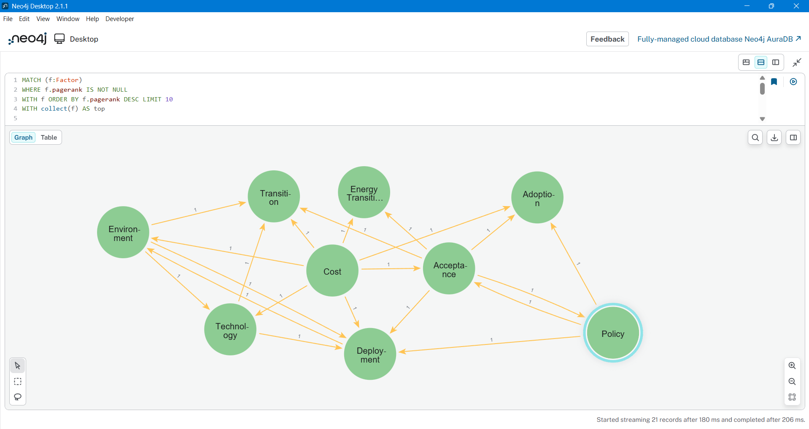
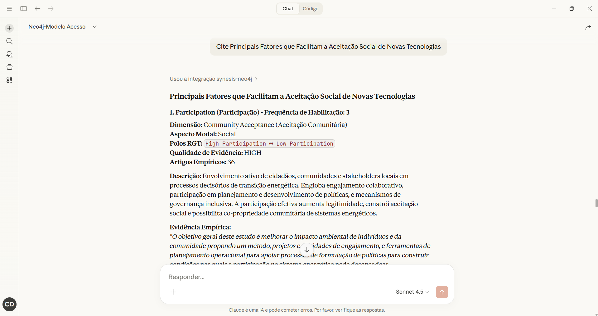
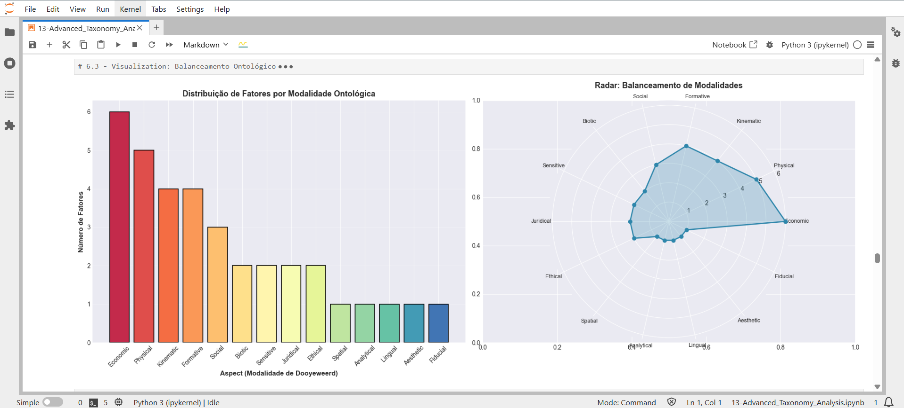
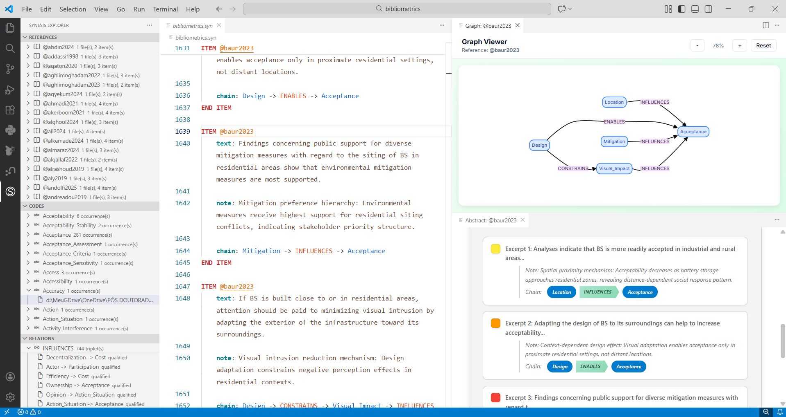
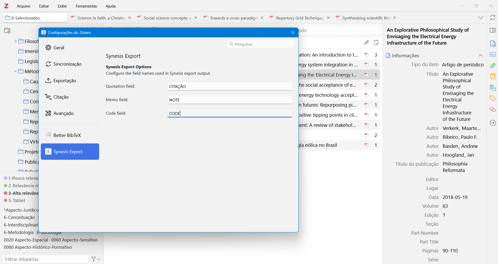
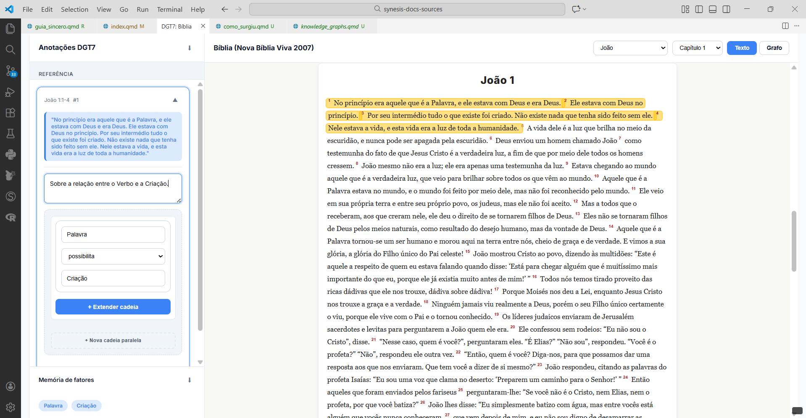

# Welcome to the Synesis Language

Human knowledge is naturally intricate, full of nuances and deep connections. That complexity is valuable; complication arises when we lack adequate methods for organizing what we know. **Synesis** is a declarative domain-specific language (DSL) created for those who need more than simple notes: it provides methods of **knowledge consolidation**.

Synesis acts as **a compiler for analytical thinking**. It receives interpretations and annotations in plain text files, validates their logical consistency and turns them into canonical, rigorous structures, organized according to objectives defined in advance by the user.

By delegating logical organization to a canonical structure, Synesis shows that discipline is a form of freedom. With the structure secured, the mind stays free for what truly matters: interpretation, nuance and insight. This is possible thanks to its level of abstraction, which sets minimal structural principles — **sources, meaningful excerpts and conceptual organization**.

This foundation gives a high degree of flexibility, allowing it to be applied to established methodologies or to custom approaches.

## Fundamental Structure

Consider knowledge recorded in books, articles, web pages, interviews or analysis records. All of it can be structured in three fundamental blocks:

- **Sources (Block 1)**: The origin of the information. It may be a scientific article, a website, an interview or an original idea written in your notebook.

- **Items (Block 2)**: The meaningful excerpt taken from the source. It is the equivalent of highlighting a passage in a book. Margin notes, keywords or codes assigned to these passages express their applied meaning and make thematic retrieval easier.

- **Ontology (Block 3)**: The way items are organized into conceptual domains. In Computer Science the term refers to the formal categorization of data into sets of knowledge. This structure may evolve over time: it can start simple and fluid, stimulating discovery and creativity, or become more stable, ensuring rigour and consistency.

## Flexibility and Maturation

In short, knowledge is organized into groups containing relevant passages (**items**), identified by codes and keywords, and extracted from references (**sources**). Synesis lets you structure and restructure these annotations continuously. As knowledge matures, its **ontology** can be refined, expanded or reorganized without compromising the structural integrity of the whole.

This approach ranges from tacit knowledge externalized as text, hypotheses and provisional ideas to consolidated analyses. Comments, time records, versioning and explicit semantic relations can be added to items, strengthening traceability and conceptual coherence.

## Applicability

The same principle applies to everyday contexts — a notepad on the desk (**Source**) with sticky notes (**Items**) organized by priority or date (**Ontology**) — and to complex academic research workflows involving scientific articles, theses and technical documentation.

Synesis is not just an organizing system but an infrastructure for translating knowledge. It converts conceptual structures into interoperable formats — from spreadsheets (**CSV**, **Excel**) to analytical notebooks (**Jupyter Lab**), standard vocabularies (**SKOS**) and graph databases (**Neo4j**, **ArcadeDB**) — making knowledge measurable, queryable and semantically navigable, including by Large Language Models (**LLMs**) via MCP.

## What Do You Need Today?

### Learn Synesis
**New here?** Start with our hands-on tutorials, which guide you step by step.

- [Getting Started](tutorials/getting-started.qmd) — Your first project, from zero to the first compilation
- [Synesis in Claude Desktop](tutorials/synesis_claude_desktop.qmd) — Start with Claude's help, with nothing to install by hand
- [Guide for Researchers](tutorials/guia_pesquisadores.qmd) — Introduction to qualitative research
- [Synesis Explorer Tutorial](tutorials/synesis_explorer_tutorial.qmd) — Set up the VS Code environment

### Solve a specific problem
**Know what you want to do?** See our practical guides for common tasks.

- [Guide for Professionals](howto/guia_profissionais.qmd) — Apply Synesis in organizational contexts
- [AI-assisted Coding](howto/synesis_coder.qmd) — Annotate with synesis-coder and review the result
- [Export to Neo4j](howto/exportar_neo4j.qmd) — Create knowledge graphs

### Consult technical specifications
**Need technical details?** Access the complete language and API reference.

- [Language Reference](reference/guia_referencia.qmd) — Complete syntax and command line
- [Error Guide](reference/guia_erros.qmd) — Every compiler diagnostic, with its fix
- [Synesis API](reference/synesis_load.qmd) — Python integration (`synesis.load()`)

### Understand concepts
**Want to understand the "why"?** Read our explanations about philosophy and architecture.

- [Why Structured Annotation Matters](explanation/por_que_estrutura_importa.qmd) — A reflection on rigour and freedom
- [Why not Excel?](explanation/guia_sincero.qmd) — When Synesis makes sense (and when it does not)
- [Knowledge Graphs and GraphRAG](explanation/knowledge_graphs.qmd) — Why graphs transform qualitative research
- [Synesis for theological research](explanation/synesis_escrituras.qmd) — How to use Synesis in theological research
- [Roadmap and Ideas](explanation/ideas.qmd) — The future of the language

---

## How It Works

The Synesis architecture is modular and entirely based on **plain text**, ensuring portability, traceability, native versioning and a distraction-free environment.

The whole system is orchestrated by a project file (*.synp*), which acts as the coordination point and connects its main components:

**Bibliographic References** (*.bib*): gather and formally structure the original sources on which the knowledge rests.

```bibtex
@article{doe2026,
    author  = {Doe, John},
    journal = {Knowledge Management},
    title   = {Exploring knowledge annotation systems},
    year    = {2026},
    number  = {7},
    volume  = {1}
}
```

**Structural Templates** (*.synt*): the normative core of the language. The template file formally defines the structure of annotations (*.syn*) and ontologies (*.syno*). It fixes the formats, required fields, relation types and declarative rules that shape the whole body of knowledge. Fully configurable, the template determines how the ontology is organized and how annotations must be structured. Like the other components, it is a plain text file.

```synesis
# ============================================
# ITEM FIELDS
# ============================================

ITEM FIELDS
    REQUIRED text
    REQUIRED BUNDLE note, chain
END ITEM FIELDS

FIELD text TYPE QUOTATION
    SCOPE ITEM
    DESCRIPTION Textual excerpt from the bibliographic source
END FIELD

FIELD note TYPE MEMO
    SCOPE ITEM
    DESCRIPTION Analytical memo explaining the interpretation and the causal mechanism identified
END FIELD

FIELD chain TYPE CHAIN
    SCOPE ITEM
    ARITY >= 2
    DESCRIPTION Causal relation between concepts
    RELATIONS
        ENABLES: A allows B to occur
        CONSTRAINS: A limits B
    END RELATIONS
END FIELD
```

**Annotations** (*.syn*): analytical records structured according to the template. They are texts organized in formal blocks, following the declared rules.

```synesis
SOURCE @doe2026
END SOURCE

ITEM @doe2026
    text: This study aims to assess the impacts of these transition plans on social equity in a case study of the southern coast of Iran, where the community faces severe water scarcity and there is ready access to seawater for desalination.

    note: Water scarcity creates necessary condition for desalination adoption, enabling transition pathway evaluation

    chain: Water_Scarcity -> ENABLES -> Desalination
END ITEM

ITEM @doe2026
    text: The main contribution of this research is to consider social equity as a key factor in the nexus evaluation of energy-water transition plans.

    note: Positions equity as essential evaluation criterion, constraining acceptable transition configurations

    chain: Equity -> CONSTRAINS -> Transition_Planning
END ITEM
```

**Ontology** (*.syno*): contains conceptual structures also defined by the template. Although they appear as structured blocks, their form and logic derive entirely from the declarations in the *.synt* file.

```synesis
ONTOLOGY Cost
    topic: Economics
    aspect: 11
    dimension: 2
    confidence: HIGH

    reasoning: Aspect 11: Core economic factor representing financial expenditure. Mainly constrains deployment/technology development while enabling market penetration when reduced. Co-occurs with Deployment and Acceptance, indicating market-consumer relevance. Dimension 2: Directly affects investors, consumers, and market competitiveness. High frequency (96) across broad sources (66) confirms central role.

    description: Economic factor representing financial expenditure associated with energy technologies and systems. Acts as primary barrier constraining technology development, site selection, and deployment when high, while enabling market penetration, technology transition, and sustainable solutions when reduced. Influences willingness to pay, acceptance, and market competitiveness. Critical determinant of renewable energy portfolio choices and infrastructure optimization decisions.

    rgt_element_a: Low_Cost
    rgt_element_b: High_Cost
    theoretical_significance: 3
END ONTOLOGY
```

While annotation and ontology files resemble texts structured in blocks, it is in the template file that Synesis truly shows itself as a language. Through declarative commands, the *.synt* file defines the structural grammar governing the whole corpus, turning a set of texts into a formally organized body of knowledge.

### The Compilation Flow

When compiling these files, Synesis validates their consistency and generates exchange formats.

```{mermaid}
flowchart LR
    %% --- NODE STYLES ---
    classDef compiler fill:#fff,stroke:#084C54,stroke-width:4px,color:#084C54,font-weight:bold;
    classDef highValue fill:#E0F7FA,stroke:#00BFA5,stroke-width:2px,color:#084C54;
    classDef defaultNode fill:#F8FAFC,stroke:#4A5568,stroke-width:1px,color:#084C84;

    %% --- DIAGRAM STRUCTURE ---
    subgraph Input ["Work Environment"]
        direction TB
        E["Ontology (.syno)"]:::defaultNode
        D["Template (.synt)"]:::defaultNode
        A["Bibliographic Sources (.bib)"]:::defaultNode
        B["Interpretive Annotations (.syn)"]:::defaultNode
    end

    %% The Central Engine
    C((("Synesis Compiler\nValidation & Logic"))):::compiler

    subgraph Output ["Exchange Formats"]
        direction TB
        F["Structured JSON"]:::defaultNode
        G["CSV/Excel Tables"]:::defaultNode
        H["SKOS / Alpaca"]:::defaultNode
    end

    subgraph Ecosystem ["Application Ecosystem"]
        direction TB
        I["Graph Databases\nNeo4j, ArcadeDB"]:::highValue
        J["Traceable AI Agents\nvia MCP"]:::highValue
        K["Data Science & Dashboards\nR, Jupyter Lab"]:::highValue
    end

    style Input fill:transparent,stroke:#4A5568,stroke-width:1px,stroke-dasharray: 5 5,color:#084C54
    style Output fill:transparent,stroke:#4A5568,stroke-width:1px,stroke-dasharray: 5 5,color:#084C54
    style Ecosystem fill:transparent,stroke:#4A5568,stroke-width:1px,stroke-dasharray: 5 5,color:#084C54

    %% --- CONNECTIONS ---
    E --> C
    D --> C
    A --> C
    B --> C

    C == "Compilation" ==> F
    C --> G
    C -.-> H

    F == "Complex Structure" ==> I
    F == "Grounded Context" ==> J
    F -. "Quantitative Analysis" .-> K
    G -. "Quantitative Analysis" .-> K

    linkStyle default stroke:#64748B,stroke-width:1px;
```

### The Power of Integration

The result of Synesis compilation goes far beyond structured documents. The compiler converts your body of knowledge into exchange formats — such as JSON, CSV, Excel, Alpaca and SKOS — making it interoperable with other technology stacks.

More than exporting data, Synesis turns structured knowledge into computational infrastructure.

#### Graph Databases

[synesis-graph](reference/synesis_graph.qmd) takes the project to Neo4j or ArcadeDB, materializing the conceptual topology of your knowledge as navigable, queryable and visually explorable graphs.



#### AI-ready

Through the MCP protocol (Model Context Protocol), your data can be connected to assistants such as Claude Desktop, enabling natural language interaction with traceable answers grounded directly in the graph database (Neo4j or ArcadeDB) — your formal source of truth.



#### Data Science

Structured datasets ready for statistical analysis in R, computational exploration in Python or interactive visualizations in Jupyter Lab.



#### VS Code Extension (LSP)

Through a Language Server Protocol (LSP) server, the editor recognizes Synesis syntax and validates in real time. The environment offers structured navigation, link inspection and basic graphical views to support analysis.



#### Zotero Plugin

[zotero-synesis-export](https://github.com/synesis-lang/zotero-synesis-export) exports PDF highlights, comments and tags from Zotero to the Synesis format, connecting academic reading to the compilation workflow.



#### Bible Coder

A VS Code extension for exegetical coding of the whole biblical text, with support for chained semantic relations (e.g. Word → ENABLES → Creation). Highlights of the canonical text can be combined through the compiler with annotations of classical, philosophical or patristic corpora, producing integrated graphs of conceptual networks.



---

## The Origin of the Name

From the Greek *σύνεσις* (sýnesis):

>**Etymology**: from **συνίημι** (*syníēmi*) — "to bring together", "to understand", "to make converge" — plus the nominal suffix -**σις** (-*sis*), which indicates action or process.

**Classical meanings:**

1. Confluence; union; convergence.
2. Understanding; discernment; intelligence.
3. Reflective awareness.

The original sense combines two inseparable movements: bringing together and understanding.

Synesis, as a language, embodies exactly that principle — the convergence of information fragments into an intelligible, auditable and formally structured whole.

*Synesis: the confluence of information into intelligence.*
