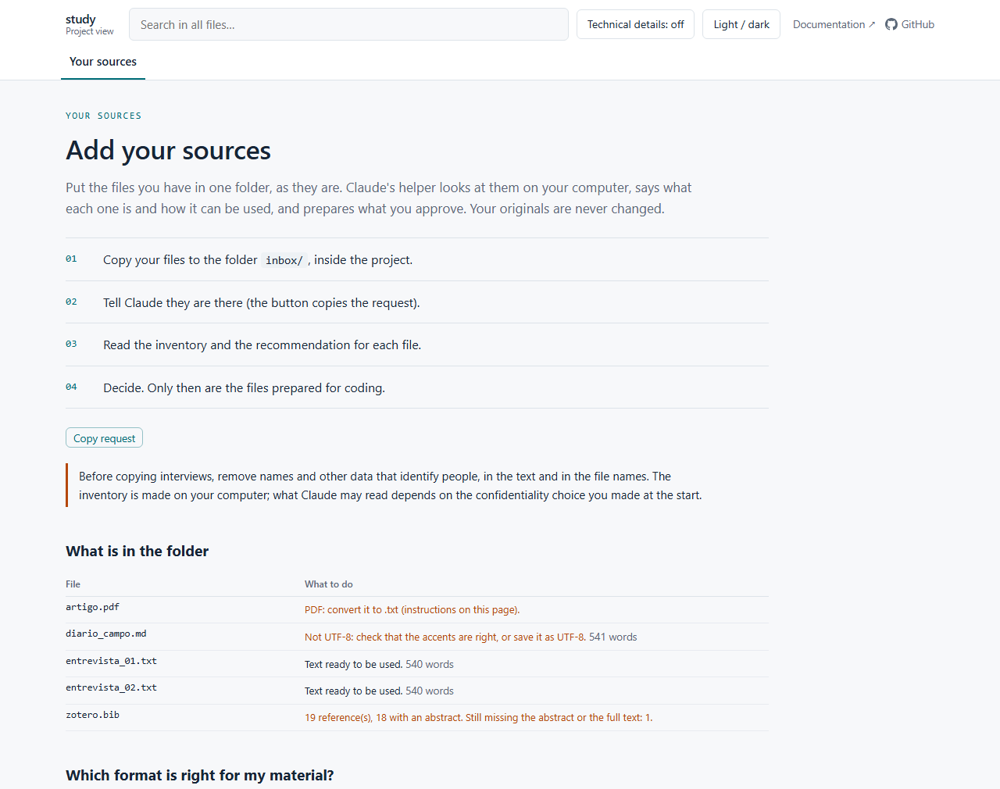
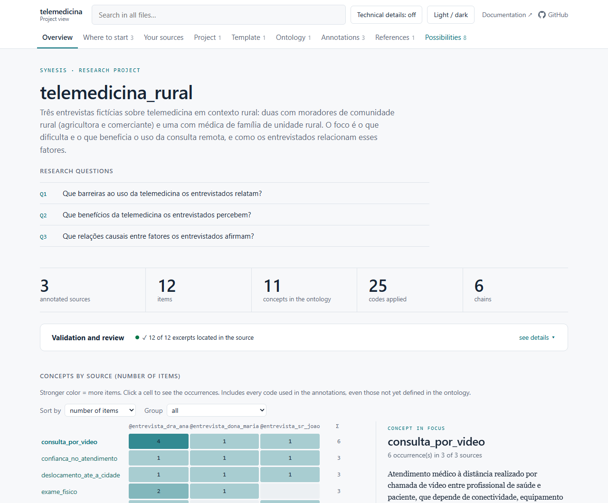
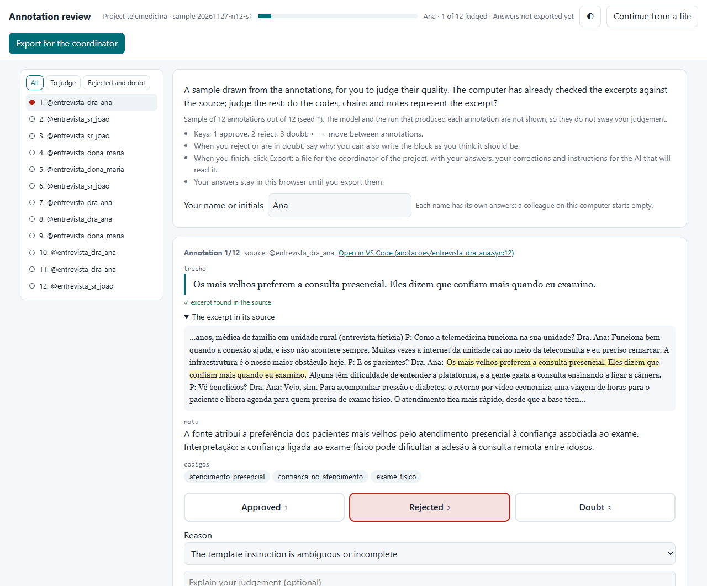

This Skill teaches Claude to run a Synesis project with you. It installs the tools, talks through your study, writes the template, runs the coding, checks every quotation against your sources, draws a sample for you to review and shows the results in pages that open on your own computer.

The division of roles is the same as everywhere in Synesis: **the AI proposes, the compiler checks, the researcher decides**. Claude leads the conversation and prepares the files. Your research questions, your categories and the approval of the template stay yours.

The Skill has a **teaching and reviewing** role: it teaches the language and the method and helps you check your data. It does not replace working directly with the Synesis tools (the compiler, the exports, the [VS Code extension](synesis_explorer_tutorial.qmd)); when a task is heavy, Claude shows you how to do it with them.



<span class="text-muted small">The video is narrated in Portuguese (episode E06 of the Synesis 101 course).</span>

::: {.callout-note}
## Status
The current version is **0.4.0**: large projects, team review and results through the Synesis tools. The Skill was tested end to end on proof projects and is **in testing with researchers**. Your feedback helps improve it (see [If something goes wrong](#if-something-goes-wrong)).
:::

## What you need

- **Claude Desktop** (Windows or macOS), on an account with access to the **Code** tab.
- **A folder** on your computer for the project, and your sources. No need to organize them first: the Skill shows where to put them and in which format (see [Add your sources](#add-your-sources)).
- **An internet connection** the first time, to install the tools.
- **About an hour** for the first session.

You do **not** need to install Python or know how to program. VS Code is optional.

::: {.callout-important}
## Code tab only
The Skill needs a terminal and your disk. It works in the **Code** tab of Claude Desktop (a local session), and **not** in claude.ai chat or Cowork.
:::

## 1. Install the Skill (once)

1. Download the Skill file: [synesis-skill.zip](../../downloads/synesis-skill.zip).
2. In Claude Desktop, open **Customize → Plugins** and use **Add** to upload the file.
3. Desktop warns you to install only plugins you trust. This is the Synesis project's plugin.

If your organization does not allow uploading plugins, ask your administrator.

::: {.callout-tip}
## Already have an earlier version?
Remove the Synesis plugin in **Customize → Plugins** and upload the new file. Your projects do not change.
:::

## 2. Open the first session

1. Open the **Code** tab and choose the **project folder**.
2. Choose the **Manual** permission mode. Claude then asks for your approval before every command, so you see what will be installed.
3. Type `/synesis` and say what you want to do. For example:

   > `/synesis` I want to code my three interviews about telemedicine with Synesis. The transcripts are in the `fontes` folder.

If you just want to try it, use the [example folder](#try-the-example).

## 3. What Claude does

In order:

1. **Asks about confidentiality** before opening any file (see [Data confidentiality](#data-confidentiality)).
2. **Installs the Synesis tools** and shows a report. This happens once per computer.
3. **Receives your sources:** creates a folder, says what each file is and recommends a format. You decide.
4. **Talks through the study:** your research questions, what to extract from the sources, whether you want free or closed categories, causal relations or scales.
5. **Writes the template** (the description of what will be coded) and shows an example. **You approve the template.**
6. **Codes each source**, one at a time, and builds the ontology of concepts.
7. **Validates and checks each quotation against the original text.**
8. **Draws a sample of the annotations for you to review** (see [Review a sample](#review-a-sample)) and shows the [results](#see-the-results).

When you come back to a project that already exists, Claude first measures its size, in a second and without reading your files, and offers a numbered list of what you can do: know the project, read it more deeply, review a sample, see the results, find out what the project can answer, fix problems, continue, export.

Throughout the work you follow the project in a page that opens in your browser: the [project view](#project-view).

At the end Claude summarizes the result: compiler errors and warnings, how many quotations were found in the sources, how many concepts the ontology has, and a list of **points worth checking in your review**.

## Add your sources {#add-your-sources}

In the first session Claude creates the `inbox/` folder and opens the **Your sources** page. Copy your files there, as they are, and tell Claude.

{fig-alt="The Your sources page of the Synesis Skill, with the steps and the inventory of the inbox"}

A program looks at the files **on your computer** and says what to do with each one. Your originals are never changed.

| What you have | Format | What is coded |
|---|---|---|
| articles, in a literature review | `.bib` with abstracts (Zotero, Mendeley, Scopus, Web of Science) | only the abstract of each reference |
| interviews, field notes, documents, full articles | `.txt`, `.md` or `.docx` | the whole text |
| forms, open answers, posts, news, curricula | `.toml`, one record per file | the sections the template points to |

::: {.callout-important}
## PDF
Convert PDF files to `.txt` (UTF-8) before adding them. The page shows how, and what to check: columns, headers, broken words, scanned pages. With no confidential data, a PDF connector for Claude can help; ask Claude.
:::

::: {.callout-warning}
## Personal data
Before copying interviews, remove names and other data that identify people, in the text **and in the file names**. You can also ask Claude for neutral keys (`ent01`, `ent02`…).
:::

## Follow the work: the project view {#project-view}

The Skill keeps the page `view/index.html`, which opens with a double click, with no internet. It is read-only and updates at every step. [Open the project view of the example](../../downloads/exemplo-telemedicina/resultado/view_en/index.html).

{fig-alt="Overview of the project view, with research questions, corpus size and the concepts-by-source matrix"}

- **Overview:** the research questions, the size of the corpus, what needs attention and the concepts-by-source matrix. Click a cell to read the excerpts.
- **Where to start:** the next steps of your project.
- **The files:** every block is a card, with its origin and its problems in plain words. Hover over the words in blue to understand the language.
- **Ask Claude:** copies a ready request about that block, for you to paste in the conversation. Claude explains and proposes, and waits for your approval.
- **Possibilities:** starts from what you want to investigate (compare, connect, organize, support an interpretation) and shows the Synesis feature that does it.

The page speaks the language of your project: English, Portuguese, Spanish, French, German, Italian or Chinese.

### Large projects

A project with thousands of annotations does not fit in a page a browser opens quickly. The view then works in *breadth and depth*, as in Big Qual (Weller et al., 2023): the numbers, the matrix (by group: the folders of the annotations or a category of the sources) and the problems always cover the whole project, but the cards shown are a selection.

| View | What it shows |
|---|---|
| **Panoramic** (default for large projects) | the whole template, one source from each of the largest groups (eight at most), the most used and a few rare concepts |
| **Sampled** | about 30 sources drawn in every group, in proportion to its size |
| **Complete** | everything, or one group, source or concept read whole |

A banner at the top says what the page shows and has buttons to ask Claude for more, with the time a complete view takes. Blocks with a problem appear even outside the selection (up to 40). On the largest test project (958 sources, 3,943 annotations) the page went from 47 MB to 2.3 MB.

## What the Skill produces

The examples below come from a real session with the three fictitious interviews in the [example folder](#try-the-example). They are ordinary Synesis text files; you can open them in any editor.

The example project is in Portuguese, so its field names and concepts are too.

::: {.grid}
::: {.g-col-12}
::: {.card .h-100}
::: {.card-header}
**Project (`telemedicina.synp`)**
:::
::: {.card-body}
The project gathers the files and records the research questions.

```synesis
PROJECT telemedicina_rural
TEMPLATE "template.synt"
INCLUDE BIBLIOGRAPHY "referencias.bib"
INCLUDE ANNOTATIONS "anotacoes"
INCLUDE ONTOLOGY "ontologia"

QUESTIONS
    Q1: Que barreiras ao uso da telemedicina os entrevistados relatam?
    Q2: Que benefícios da telemedicina os entrevistados percebem?
    Q3: Que relações causais entre fatores os entrevistados afirmam?
END QUESTIONS
...
END PROJECT
```
:::
:::
:::
::: {.g-col-12}
::: {.card .h-100 .hang-12}
::: {.card-header}
**Template (`template.synt`)**
:::
::: {.card-body}
Every field has instructions (GUIDELINES) with examples from another topic, so the model does not copy from your sources.

```synesis
FIELD trecho TYPE QUOTATION
    SCOPE ITEM
    DESCRIPTION Trecho copiado literalmente da fala do entrevistado
    GUIDELINES
        Copie de uma a três frases contínuas, exatamente como aparecem na fonte.
        Copie apenas falas do entrevistado, nunca as perguntas do entrevistador.
        Não corrija, não resuma, não junte frases distantes.
        Correto: "Depois que pintaram a faixa, comecei a ir de bicicleta todo dia."
        Errado: "A moradora passou a usar a bicicleta diariamente após a faixa."
    END GUIDELINES
END FIELD
```
:::
:::
:::
::: {.g-col-12}
::: {.card .h-100}
::: {.card-header}
**Annotations (`anotacoes/`)**
:::
::: {.card-body}
Each excerpt becomes an ITEM: the literal quotation, the note, the codes and, when the source states it, a chain.

```synesis
SOURCE @entrevista_dona_maria
    descricao: Entrevista fictícia com agricultora de 62 anos, moradora de comunidade rural, sobre o uso de consulta por vídeo.
END SOURCE

ITEM @entrevista_dona_maria
    trecho: O doutor não me tocou, não olhou a minha perna de perto. Para mim, médico bom é aquele que põe a mão na gente. Se não pode examinar, eu fico achando que ele não viu direito.
    nota: A fonte afirma que a ausência de toque e exame físico gera desconfiança sobre a qualidade do atendimento; sugere barreira de natureza cultural e de confiança, distinta da técnica.
    codigos: exame_fisico, confianca_no_atendimento
    cadeia: exame_fisico -> HABILITA -> confianca_no_atendimento
END ITEM
```
:::
:::
:::
::: {.g-col-12}
::: {.card .h-100}
::: {.card-header}
**Ontology (`ontologia/`)**
:::
::: {.card-body}
Each concept gets a definition with a criterion for applying it, and a theme.

```synesis
ONTOLOGY exame_fisico
    definicao: Avaliação clínica direta do corpo do paciente por meio de toque, inspeção e palpação durante o atendimento, percebida pelos entrevistados como sinal de que o médico examinou de fato. Aplica-se quando a fonte menciona a presença, a ausência ou a necessidade desse contato físico no atendimento; não se aplica a conversa ou observação apenas por vídeo sem referência ao exame.
    grupo: pratica_clinica
END ONTOLOGY
```
:::
:::
:::
:::

## 4. Review a sample {#review-a-sample}

Claude draws a sample of the annotations (30 by default, spread over the groups of the project) and builds the **review** page at `review/index.html`. [Open the example review](../../downloads/exemplo-telemedicina/resultado/review_en/index.html).

{fig-alt="Review page of the Synesis Skill: one annotation with the excerpt in its source, the codes and the Approved, Rejected and Doubt buttons"}

1. Write your name or initials.
2. Read the excerpt (the computer already checked that it is in the source; open *The excerpt in its source* to read around it) and what was coded.
3. Choose **Approved**, **Rejected** or **Doubt** (keys 1, 2, 3). If you reject or doubt, choose a reason and, if you like, write a note or **propose a correction**: the block as you think it should be.
4. Click **Export for the coordinator**. You get one `.md` file with your answers, your corrections and instructions for the AI that will read it.

The sample is fixed when it is drawn: you judge the annotations as they were then. The page does not show which model produced each annotation, so it does not sway you, and it shows the rejection **observed in the sample**; since the sample gives more weight to small groups, Claude reports a separate estimate for the whole project.

::: {.callout-tip}
## As a team
The coordinator sends the review page to each researcher (it contains excerpts of the sources: send it only to people allowed to read them). Everyone judges on their own computer, with their own name, and sends the exported file to the coordinator, who gives them all to Claude. Claude reports how much you agree (Cohen's kappa, Krippendorff's alpha) and puts the proposed corrections side by side. A correction enters the project only when the coordinator approves it.
:::

## 5. See the results {#see-the-results}

The results page is in `dashboard/dashboard.html`. It opens with a double click, with no internet and no server.

| Tab | What it shows |
|---|---|
| **Fontes** (Sources) | each coded excerpt, with its quotation, note and codes. The quotation appears as *found*, *not found* or *unverifiable* in the original text |
| **Códigos** (Codes) | each code, with its definition and all its evidence |
| **Relações** and **Questões** (Relations, Questions) | the relations between concepts and where the evidence for each research question is |
| **Conferência** (Review) | the result of each review: approved, rejected, doubt, reasons, proposed corrections, agreement |
| **Qualidade** (Quality) | what still needs attention |
| **Método** (Method) | the full template and how the result was produced |

::: {.callout-note}
## Large projects
In a large project Claude does not build this page: it would be slow to make and heavy to open. It shows you how to read the results with the Synesis tools, which also teaches you to use them:

```bash
synesis compile project.synp --xls results.xlsx   # a spreadsheet, in seconds (also --csv or --json)
synesis export project.synp                       # the exports the project declares
```

Or use the [Synesis extension for VS Code](synesis_explorer_tutorial.qmd). The project view and the review work at any size.
:::

When something is wrong, Claude does not fix the excerpt by hand. It classifies the problem with you first: an ambiguous instruction in the template, a one-off failure, a badly converted source text, or a legitimate difference of interpretation.

## Try the example {#try-the-example}

Want to see the Skill at work without using your own sources? Download the [example folder](../../downloads/exemplo-telemedicina.zip). It holds:

- **`fontes/`**: three fictitious interviews about telemedicine in rural communities, ready for the Skill to code. Copy the folder somewhere new, open it in the **Code** tab and type:

  > `/synesis` I want to code my three interviews about telemedicine. The transcripts are in fontes.

- **`resultado/`**: what the Skill produced in a real session with those interviews, so you can compare with yours: project, template, annotations, ontology and the three pages. To see them now: the [project view](../../downloads/exemplo-telemedicina/resultado/view_en/index.html), the [review](../../downloads/exemplo-telemedicina/resultado/review_en/index.html) and the [results](../../downloads/exemplo-telemedicina/resultado/dashboard/dashboard.html).

::: {.callout-note}
The coding is done by an AI model. Your result will be similar to the one in `resultado/`, not identical: compare structure and criteria, not every word.
:::

## Costs

There are two coding modes, and Claude explains both before starting:

| Mode | Who codes | Cost |
|---|---|---|
| **Claude session** | the Claude of your own subscription | within the limits of your plan |
| **API** | a model through an API key (Anthropic, OpenRouter) | billed by the provider; Claude runs a pilot with 2 or 3 sources and shows the cost before coding everything |

::: {.callout-warning}
## API keys
Never type an API key into the chat. Claude creates a `.env` file in the project folder with the field empty, and you paste the key directly into it.
:::

## Data confidentiality {#data-confidentiality}

Everything Claude reads leaves your computer and goes to Anthropic (and, in API mode, to the chosen provider). That is why Claude asks before opening your sources and proposes a modality:

- **A. Cloud:** Claude reads the sources. Use it when there is no confidential data.
- **B. Reduced exposure:** Claude works only with the method and invented examples; coding runs on a local model (Ollama). This is not fully local processing.
- **C. Local:** Claude does not take part. For data under strict legal or ethical confidentiality, use Synesis in VS Code with a local model.

## What stays in the project folder

| File or folder | Content |
|---|---|
| `*.synp` | the project |
| `template.synt` | the method |
| `*.bib` | the bibliographic sources |
| `inbox/` | your original files; do not share it if it has personal data |
| `fontes/` | the prepared texts |
| `anotacoes/`, `ontologia/` | the result of the coding |
| `runs/` | the record of every run: what was asked of the model, what it answered and the decisions you made |
| `view/`, `review/`, `dashboard/`, `saida/` | generated files, which can be rebuilt at any time (review answers are kept in `runs/` once imported) |

Keep the whole folder; when you share it, leave out the `.env` and the `inbox/`. With it, anyone can rebuild your results and your pages. The files are plain Synesis files: you can open them in [VS Code](synesis_explorer_tutorial.qmd) whenever you like.

## If something goes wrong {#if-something-goes-wrong}

- **"command not found"** right after installation: open a new session in the Code tab. In the same session, Claude uses the full path to the tools.
- **Windows blocked the installer:** Claude tries another route. On an institutional machine you may need to talk to IT support.
- **Questions about the language:** ask Claude, which consults the installed reference guide.
- **Synesis errors and suggestions:** open an *issue* at <https://github.com/synesis-lang/synesis/issues>.

## Next steps

- [Guide for Researchers](guia_pesquisadores.qmd): a hands-on project, without the Skill.
- [Language Reference](../reference/guia_referencia.qmd)
