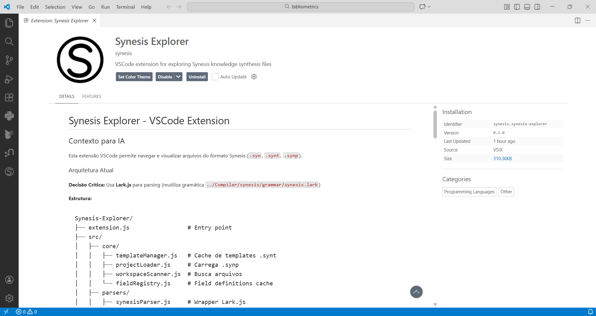
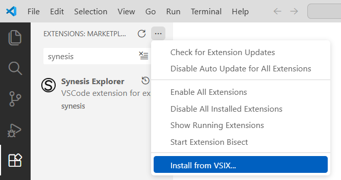
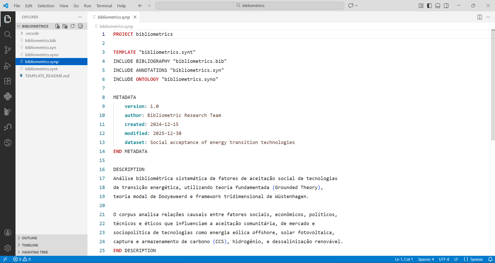
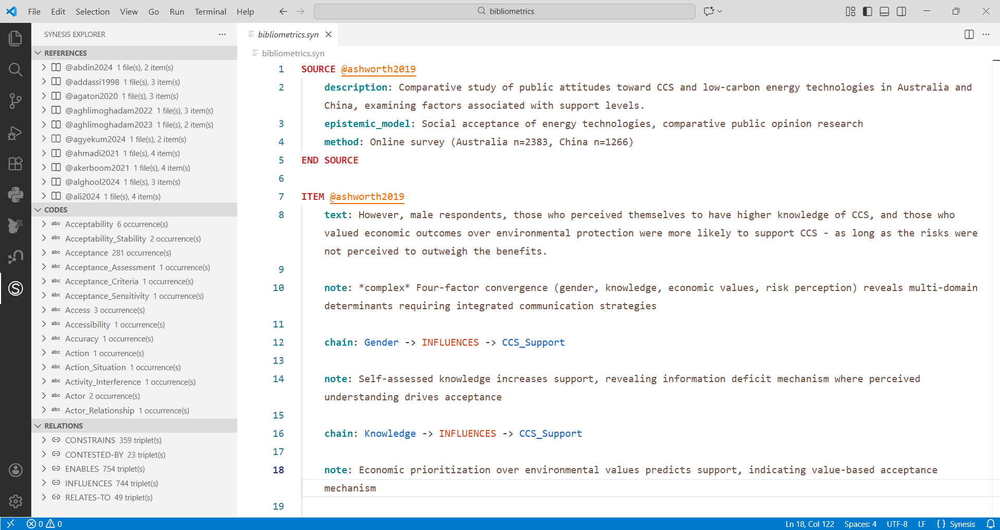
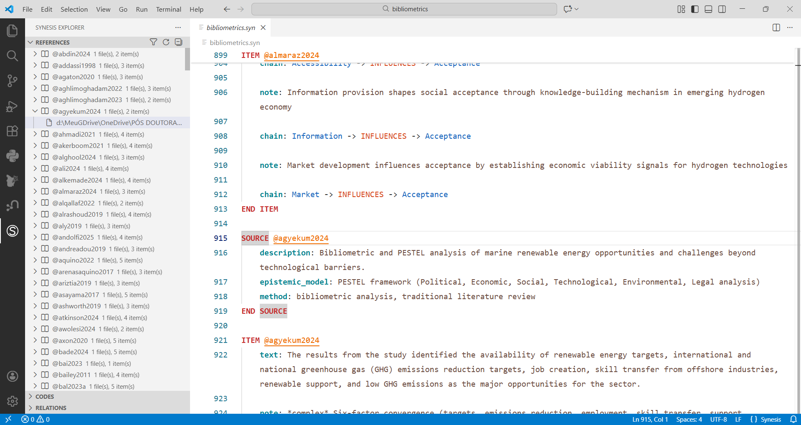
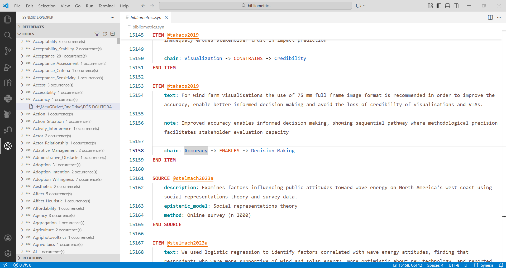
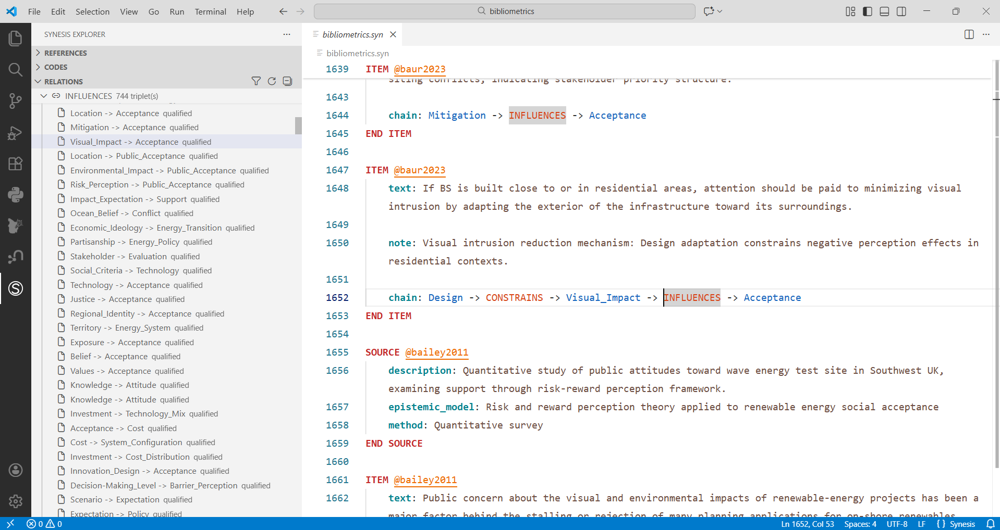
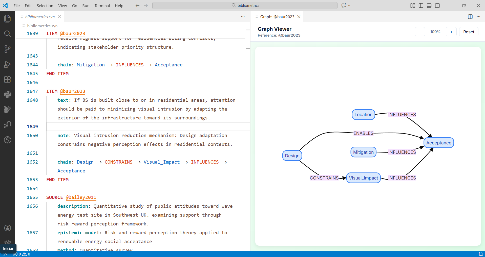
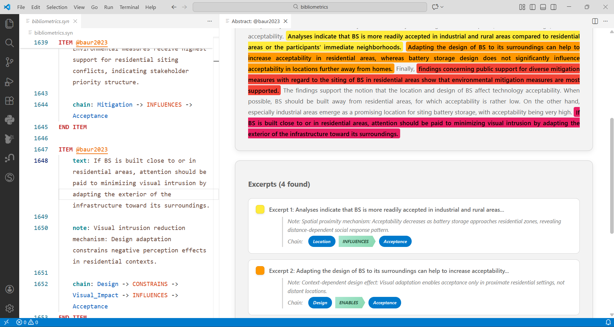
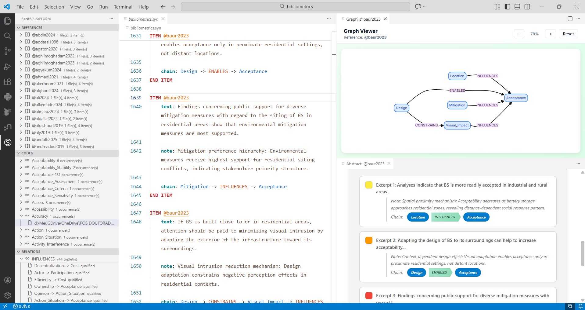

# Quick Guide: the Synesis Extension for VS Code

**Goal:** help you install and use the **Synesis** extension (version 0.17) to write and navigate Synesis files (`.synp`, `.synt`, `.syn`, `.syno`, `.synr`). The extension is also known as Synesis Explorer.

---

## What the Extension Does

- Validates files as you type and completes fields, codes and relations
- Shows references, codes, relations, ontology and template fields in side panels
- Opens relation graphs and the abstracts of references
- Codes a selected passage with `synesis-coder`
- Chats with a graph database of the project in VS Code chat



---

## Requirements

- VS Code
- Python 3.10 or later
- The compiler and the language server, which do the analysis (the extension is the interface):

```bash
pip install synesis synesis-lsp
```

---

## Installation

1. In VS Code, open the Extensions view (`Ctrl+Shift+X`)
2. Search for **Synesis** (publisher `synesis-lang`)
3. Click **Install**

To install from a `.vsix` file, use the `...` menu of the Extensions view and **Install from VSIX...**.



---

## First Project

In an empty folder:

```bash
synesis init
```

Open the folder in VS Code. The Synesis icon appears in the Activity Bar and the panels fill in.



---

## The Panels



| Panel | Shows |
|---|---|
| **References** | the sources (`SOURCE`), with their items nested |
| **Codes** | the codes and every occurrence |
| **Relations** | the chains (`CHAIN`), grouped by source |
| **Ontology Topics** | ontology topics; with `ROLE HIERARCHY`, the concept tree |
| **Ontology (Annotations)** | where concepts are used in `.syn` files |
| **Template Fields** | template fields, by scope |

Some panels appear according to the type of file open. Click an entry to jump to the exact line. Each panel has refresh and filter buttons.







In the ontology tree, the context menu of a concept offers **Subtree Evidence**: the items of the concept and of all its descendants.

---

## Graphs and Abstracts

| Action | Shortcut (Windows/Linux) | Mac |
|---|---|---|
| Relation graph per source | `Ctrl+Alt+G` | `Cmd+Shift+G` |
| Graph per file | `Ctrl+Alt+F` | `Cmd+Shift+F` |
| Graph per item | `Ctrl+Alt+I` | `Cmd+Alt+I` |
| Abstract of the reference | `Ctrl+Shift+A` | `Cmd+Shift+A` |
| Code the selection with AI | `Ctrl+Shift+I` | `Cmd+Shift+I` |





---

## Editing

- **Real-time diagnostics:** errors and warnings underlined and listed in the *Problems* panel (`Ctrl+Shift+M`)
- **Autocompletion:** fields, codes, relations, list values, roles after `ROLE` and `EXPORT` properties
- **Hover:** field definition; on concepts, parents, children and amount of evidence
- **Go to definition** (`F12`) and **rename** (`F2`) codes and references across the project
- **Snippets:** type `field-chain`, `field-scale`, `field-ordered`… or `SOURCE`, `ITEM`, `ONTOLOGY` and press `Tab`; annotation blocks carry the required fields of **your** template
- **Themes:** *Synesis Dark* and *Synesis Light*

---

## Coding with AI

Install `synesis-coder` (`pip install synesis-coder`), set the key in the project's `.env`, select a passage in a `.syn` and run **Synesis: Code Selection** (`Ctrl+Shift+I`). See [AI Coding](../howto/synesis_coder.qmd).

---

## Chatting with the Graph

The extension registers a chat participant that queries an ArcadeDB database of the project, created by [`synesis-graph`](../reference/synesis_graph.qmd). The commands **Synesis: Settings** (connections and providers), **Synesis: Select Chat Graph Database** and **Synesis: Show Turn Evidence and Queries** configure the chat and show the audit trail of each answer. Keys are kept in VS Code's secure storage.

---

## Settings

In *Settings*, search for "Synesis" (prefix `synesisExplorer.`):

| Setting | Purpose |
|---|---|
| `lsp.pythonPath` | path to the `synesis-lsp` executable, if not on `PATH` |
| `lsp.enabled` | turns the server on or off |
| `diagnostics.enabled` | shows the underlines |
| `diagnostics.checkCodes` | warns on every code missing from the ontology (off by default: one summary on the `.synp`) |
| `inlayHints.enabled` | shows "(Author, Year)" after references |
| `semanticHighlighting.enabled` | highlighting based on the syntax tree |
| `completion.autoImportCodes` | offers ontology codes on completion |
| `coder.path` | path to `synesis-coder` |

---

## Common Problems

**The panels are empty.** Check that the open folder has a `.synp` file and that `synesis-lsp` is installed (see the *Synesis LSP* output channel).

**A panel is missing.** Several depend on the type of file open: open a `.syn` or `.syno`.

**"Failed to start Synesis LSP".** Set `synesisExplorer.lsp.pythonPath` to the full path of the executable.

**Relations do not show.** Check that the template has a `TYPE CHAIN` field and that chains are annotated.

---

## Ready to Go

With this you can write, validate, navigate and visualize your Synesis data in VS Code.


