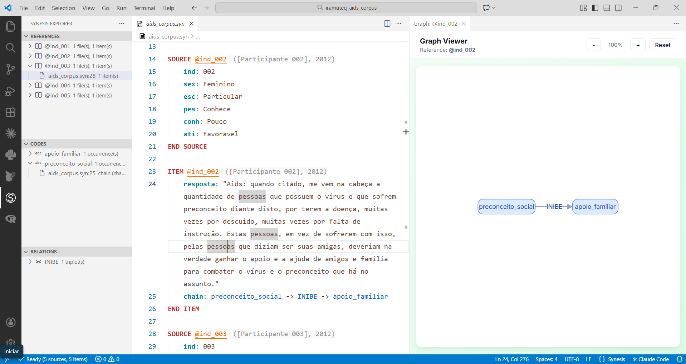

# Synesis for IRaMuTeQ Users

This tutorial is for researchers who already know IRaMuTeQ and want to understand how the Synesis language can complement — and extend — their qualitative analysis workflow.

**You will learn to:**

- Structure a corpus directly in Synesis, from data collection on
- Create a typed template with automatic validation
- Generate the IRaMuTeQ corpus from the Synesis project
- Add annotation layers that feed analyses beyond IRaMuTeQ

**Prerequisite:** familiarity with the IRaMuTeQ corpus format (`****` lines, variables and modalities).

---

## The Problem: the IRaMuTeQ Corpus Is a Destination, Not a Source

The traditional workflow starts outside the software: the researcher prepares a `.txt` file with `****` lines, usually in a text editor, and loads it for analysis. Nothing validates the research design: a non-existent modality or a missing field produces silent noise in the results.

For small corpora and solo researchers this is manageable. For hundreds of texts, several coders or distinct collection phases, it becomes a real methodological risk.

Synesis inverts the flow: the corpus is kept in Synesis from the start, validated by the compiler at every edit, and converted to IRaMuTeQ on demand. The IRaMuTeQ `.txt` becomes a **derived artifact**, generated from the canonical source.

---

## Part 1 — The IRaMuTeQ Corpus and Its Structure

IRaMuTeQ organizes the corpus with **command lines** preceding each text. Each line starts with `****` and lists variables in the form `*name_value`.

### Example: the "aids" Corpus

This corpus gathers answers to the question *"What do you think about Aids?"*, collected from secondary school students (Antunes, 2012). It is one of the canonical examples for Descending Hierarchical Classification (DHC) with short answers. The texts are in Portuguese, as in the original.

:::{.callout-note}
## IRaMuTeQ Tutorial
The examples in this tutorial come from the IRaMuTeQ user manual [@camargo2021].

The [case-study repository](https://github.com/synesis-lang/case-studies/tree/main/Sociology/iramuteq_aids_corpus) holds the ready-to-use project.
:::

| Variable | Description | IRaMuTeQ modalities |
|----------|-----------|-------------|
| `*ind`   | Participant | 001 to 312 |
| `*sex`   | Sex | 1 = male, 2 = female |
| `*sch`   | Type of school | 1 = public, 2 = private |
| `*kno`   | Knows someone HIV-positive | 1 = yes, 2 = no |
| `*tra`   | Knowledge about transmission | 1 = good, 2 = little |
| `*att`   | Attitude towards HIV-positive people | 1 = favorable, 2 = neutral, 3 = unfavorable |

```text
**** *ind_001 *sex_1 *sch_2 *kno_2 *tra_1 *att_3
A aids é um vírus que tem que tomar muito cuidado. É importante conhecer
seu parceiro na hora de realizar atos sexuais. O vírus pode ser transmitido
por causa de um ato irresponsável, transar sem o uso de um preservativo,
ou através de um estupro.
**** *ind_002 *sex_2 *sch_2 *kno_1 *tra_2 *att_1
Aids: quando citado, me vem na cabeça a quantidade de pessoas que possuem
o vírus e que sofrem preconceito diante disto, por terem a doença.
```

Each `****` block is an **initial context unit**: the values after `****` are the respondent's metadata and the following text is the analysed content.

---

## Part 2 — Creating the Synesis Template

The template (`.synt`) declares the fields, their types and their rules. In Synesis the modalities have readable names; the numeric IRaMuTeQ code is applied only on export.

<!-- file: aids_corpus.synt -->
```synesis
TEMPLATE aids_corpus version: "1.0"

# ============================================
# SOURCE FIELDS
# ============================================

SOURCE FIELDS
    REQUIRED ind, sex, sch, kno, tra, att
END SOURCE FIELDS

FIELD ind TYPE TEXT
    SCOPE SOURCE
    DESCRIPTION Unique participant identifier
END FIELD

FIELD sex TYPE ENUMERATED
    SCOPE SOURCE
    DESCRIPTION Sex of the participant
    VALUES
        Male: Male
        Female: Female
    END VALUES
END FIELD

FIELD sch TYPE ENUMERATED
    SCOPE SOURCE
    DESCRIPTION Type of school attended
    VALUES
        Public: Public school
        Private: Private school
    END VALUES
END FIELD

FIELD kno TYPE ENUMERATED
    SCOPE SOURCE
    DESCRIPTION Knows someone HIV-positive
    VALUES
        Knows: Knows at least one HIV-positive person
        Does_not_know: Knows no HIV-positive person
    END VALUES
END FIELD

FIELD tra TYPE ENUMERATED
    SCOPE SOURCE
    DESCRIPTION Knowledge about HIV transmission
    VALUES
        Good: Good knowledge
        Little: Little knowledge
    END VALUES
END FIELD

FIELD att TYPE ENUMERATED
    SCOPE SOURCE
    DESCRIPTION Attitude towards HIV-positive people
    VALUES
        Favorable: Favorable attitude
        Neutral: Neutral attitude
        Unfavorable: Unfavorable attitude
    END VALUES
END FIELD

# ============================================
# ITEM FIELDS
# ============================================

ITEM FIELDS
    REQUIRED answer
    OPTIONAL chain
END ITEM FIELDS

FIELD answer TYPE QUOTATION
    SCOPE ITEM
    DESCRIPTION Answer to the open question about Aids
    GUIDELINES
        Copy the whole answer, without correcting spelling.
    END GUIDELINES
END FIELD

FIELD chain TYPE CHAIN
    SCOPE ITEM
    ARITY >= 2
    DESCRIPTION Relation between ideas stated in the answer
    RELATIONS
        INHIBITS: one concept reduces or blocks another
        PROMOTES: one concept favors or expands another
        ASSOCIATES: association between concepts
    END RELATIONS
END FIELD

# ============================================
# ONTOLOGY FIELDS
# ============================================

ONTOLOGY FIELDS
    REQUIRED definition
    OPTIONAL group
END ONTOLOGY FIELDS

FIELD definition TYPE TEXT
    SCOPE ONTOLOGY
    DESCRIPTION Definition of the concept in the context of representations of Aids
END FIELD

FIELD group TYPE TOPIC
    SCOPE ONTOLOGY
    DESCRIPTION Thematic grouping of the concept
END FIELD
```

**Why it matters:** an attempt to record `att: Neutro` or `sex: Other` is rejected by the compiler before the datum reaches IRaMuTeQ, with a suggestion of the closest value.

---

## Part 3 — Structuring the Corpus in Synesis

Each respondent is a `SOURCE` + `ITEM` pair. File `aids_corpus.syn`:

<!-- file: aids_corpus.syn -->
```synesis
SOURCE @ind_001
    ind: 001
    sex: Male
    sch: Private
    kno: Does_not_know
    tra: Good
    att: Unfavorable
END SOURCE

ITEM @ind_001
    answer: "A aids é um vírus que tem que tomar muito cuidado. É importante conhecer seu parceiro na hora de realizar atos sexuais."
END ITEM

SOURCE @ind_002
    ind: 002
    sex: Female
    sch: Private
    kno: Knows
    tra: Little
    att: Favorable
END SOURCE

ITEM @ind_002
    answer: "Aids: quando citado, me vem na cabeça a quantidade de pessoas que possuem o vírus e que sofrem preconceito diante disto, por terem a doença."
    chain: social_prejudice -> INHIBITS -> family_support
END ITEM

SOURCE @ind_003
    ind: 003
    sex: Female
    sch: Private
    kno: Does_not_know
    tra: Little
    att: Unfavorable
END SOURCE

ITEM @ind_003
    answer: "Eu penso que é uma questão complicada, porque a pessoa fica mal e tem que viver de remédios e tem medo de passar pra outra."
END ITEM
```

The ontology (`aids_corpus.syno`) defines the concepts used in chains:

<!-- file: aids_corpus.syno -->
```synesis
ONTOLOGY social_prejudice
    definition: Rejection of or discrimination against HIV-positive people
    group: social_dimension
END ONTOLOGY

ONTOLOGY family_support
    definition: Help from relatives and friends to people living with HIV/Aids
    group: social_dimension
END ONTOLOGY
```

The bibliography (`aids_corpus.bib`) has one entry per respondent, with a neutral key:

<!-- file: aids_corpus.bib -->
```bibtex
@misc{ind_001, author = {Participant 001}, title = {Answer 001}, year = {2012}}
@misc{ind_002, author = {Participant 002}, title = {Answer 002}, year = {2012}}
@misc{ind_003, author = {Participant 003}, title = {Answer 003}, year = {2012}}
```

And the project (`aids_corpus.synp`):

<!-- file: aids_corpus.synp -->
```synesis
PROJECT aids_corpus
    TEMPLATE "aids_corpus.synt"
    INCLUDE BIBLIOGRAPHY "aids_corpus.bib"
    INCLUDE ANNOTATIONS "aids_corpus.syn"
    INCLUDE ONTOLOGY "aids_corpus.syno"
END PROJECT
```



---

## Part 4 — Generating the IRaMuTeQ Corpus

The compiler has **no** IRaMuTeQ exporter. The conversion is a short step over the compiled JSON. First:

```bash
synesis compile aids_corpus.synp --json corpus.json
```

Then save this script as `to_iramuteq.py`:

<!-- script: to_iramuteq.py -->
```python
import json
import re

# Numeric code IRaMuTeQ will receive for each modality
CODES = {
    "sex": {"Male": "1", "Female": "2"},
    "sch": {"Public": "1", "Private": "2"},
    "kno": {"Knows": "1", "Does_not_know": "2"},
    "tra": {"Good": "1", "Little": "2"},
    "att": {"Favorable": "1", "Neutral": "2", "Unfavorable": "3"},
}
VARIABLES = ["ind", "sex", "sch", "kno", "tra", "att"]
TEXT_FIELD = "answer"

with open("corpus.json", encoding="utf-8") as f:
    data = json.load(f)

lines = []
for item in data["corpus"]:
    key = item["source_ref"].lstrip("@")
    source = data["bibliography"][key]        # includes the SOURCE fields
    marks = []
    for var in VARIABLES:
        value = str(source[var])
        if var == "ind":
            value = value.zfill(3)            # 001 is read as the number 1
        marks.append(f"*{var}_{CODES.get(var, {}).get(value, value)}")
    text = item["data"][TEXT_FIELD].strip().strip('"')
    text = re.sub(r"[*$%\"]", " ", text)      # characters IRaMuTeQ reserves
    lines.append("**** " + " ".join(marks))
    lines.append(text)

with open("aids_iramuteq.txt", "w", encoding="utf-8") as f:
    f.write("\n".join(lines) + "\n")

print(f"{len(data['corpus'])} texts written to aids_iramuteq.txt")
```

```bash
python to_iramuteq.py
```

The generated file opens in IRaMuTeQ (UTF-8 encoding):

```text
**** *ind_001 *sex_1 *sch_2 *kno_2 *tra_1 *att_3
A aids é um vírus que tem que tomar muito cuidado. É importante conhecer seu parceiro na hora de realizar atos sexuais.
**** *ind_002 *sex_2 *sch_2 *kno_1 *tra_2 *att_1
Aids: quando citado, me vem na cabeça a quantidade de pessoas que possuem o vírus e que sofrem preconceito diante disto, por terem a doença.
```

| Synesis | IRaMuTeQ |
|---------|----------|
| `SOURCE` block | variables of the `****` line |
| Field `sex: Male` | `*sex_1` |
| Field `att: Unfavorable` | `*att_3` |
| `QUOTATION` field of the `ITEM` | text following the `****` line |

Adapt `CODES`, `VARIABLES` and `TEXT_FIELD` to your template. From there on, DHC, similarity analysis, correspondence analysis and word clouds proceed as usual, with the guarantee that the corpus was validated first.

---

## Part 5 — Synesis as an Analysis Hub

The main advantage of keeping the corpus in Synesis is that one source feeds several destinations:

```text
Synesis corpus (.synp + .bib + .syn + .synt + .syno)
        │
        ├──► the compiler validates against the template
        │       └── errors reported before analysis
        │
        ├──► JSON ──► script ──► IRaMuTeQ (.txt)
        │                         └── DHC, similarity, CA, word cloud
        │
        ├──► CSV / Excel ──► spreadsheets, R, pandas
        │
        ├──► synesis.load() in Jupyter
        │         ├── sources     → SOURCE variables
        │         ├── items       → texts and ITEM fields
        │         ├── ontologies  → concepts
        │         └── chains      → relations
        │
        ├──► synesis-graph ──► graph (HTML, Neo4j, ArcadeDB)
        │
        └──► further coding in the corpus itself
                ├── CODE, CHAIN   (categories and relations)
                ├── MEMO          (analytical notes)
                └── SCALE         (scores per item)
```

### Adding Annotations to the Corpus

After running the DHC and identifying thematic classes, return to the corpus and enrich it. For instance, add an `ENUMERATED` field to the template for the DHC class, or record a relation:

```synesis
ITEM @ind_002
    answer: "Quando citado, me vem na cabeça a quantidade de pessoas que sofrem preconceito."
    chain: social_prejudice -> INHIBITS -> family_support
END ITEM
```

These annotations do not change the IRaMuTeQ `.txt`, but they are available to the graph, to the tables and to a second IRaMuTeQ round with variables derived from the coding.

### Programmatic Access

```python
import synesis

project = synesis.SynesisCompiler("aids_corpus.synp").compile()
project.to_csv("tables/")      # sources.csv, items.csv, chains.csv...
```

To work entirely in memory, with DataFrames, use [`synesis.load`](../reference/synesis_load.qmd).

---

## Part 6 — Synesis as a Governance Layer

For solo researchers with small corpora, IRaMuTeQ alone is enough. Synesis makes a difference in three scenarios:

**Large corpora.** With hundreds of participants, typos in variables are likely. The compiler catches them before analysis.

**Team work.** The template works as a contract: fields, allowed values and relations live in one versionable file. Divergences show at compile time.

**Longitudinal research.** As the corpus grows, the template keeps integrity across versions, and conceptual decisions can be documented in the `.syno`:

```synesis
# DECISION 2026-03-01: we split "prejudice" into two concepts after
# telling declared prejudice apart from reported behaviour.

ONTOLOGY declared_prejudice
    definition: Verbal expression of a discriminatory attitude
    group: social_dimension
END ONTOLOGY

ONTOLOGY behavioural_prejudice
    definition: Discriminatory action reported by the participant
    group: social_dimension
END ONTOLOGY
```

---

## Summary

| Aspect | IRaMuTeQ | Synesis + IRaMuTeQ |
|---------|----------|--------------------|
| Corpus validation | File format | Fields and modalities of the design |
| Canonical source | `.txt` file | `.syn` corpus + `.synt` template |
| Destinations | Internal results | IRaMuTeQ (via script), CSV, JSON, Excel, graphs |
| Interpretive annotation | Not supported | CODE, CHAIN, MEMO, SCALE |
| Team work | Manual | Template as contract |
| Programmatic access | Not available | Python API |

IRaMuTeQ remains the right tool for DHC, similarity and correspondence analysis. Synesis does not replace these analyses: it governs the corpus that feeds them and opens it to others.

---

## Next Steps

- [How to Define an Ontology](../howto/definir_ontologia.qmd)
- [How to Create Chains](../howto/criar_chains.qmd)
- [Language Reference](../reference/guia_referencia.qmd)

---

**Questions?** Check [GitHub Discussions](https://github.com/synesis-lang/synesis/discussions) or open an issue in the repository.

---

## References
