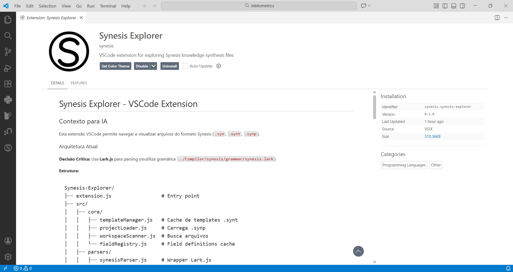
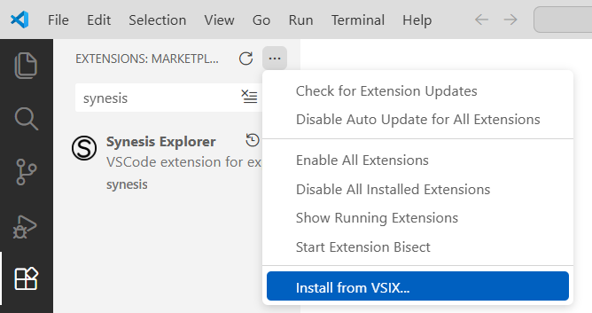
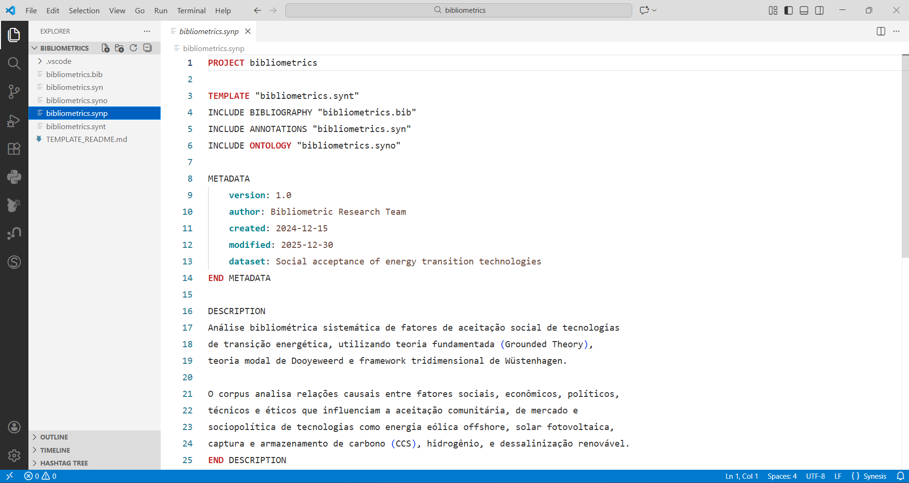
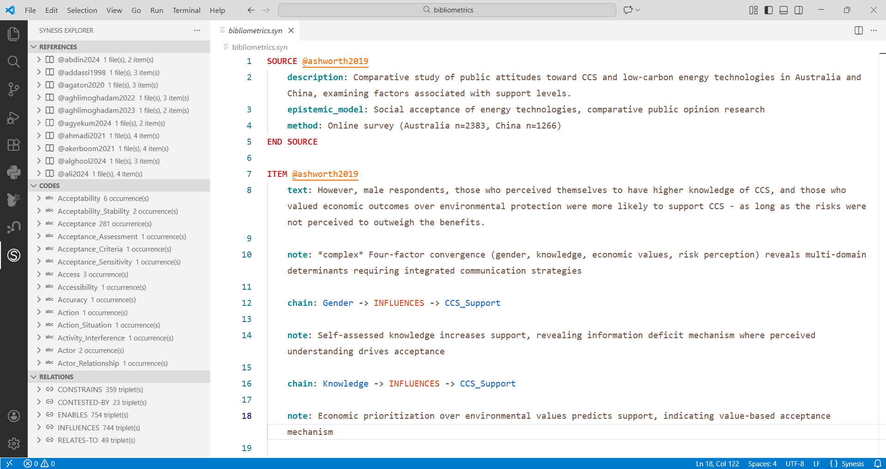
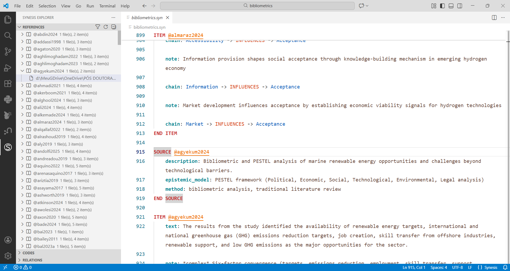
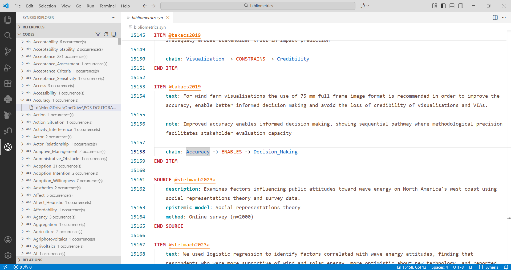
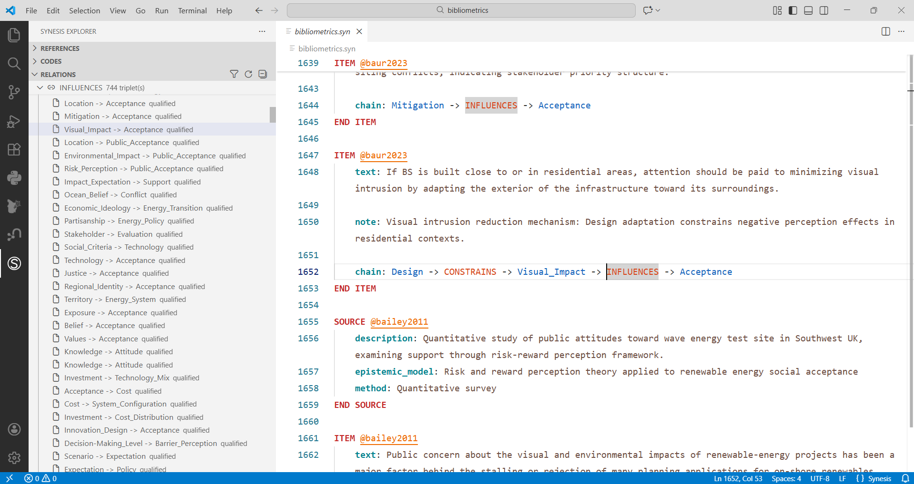
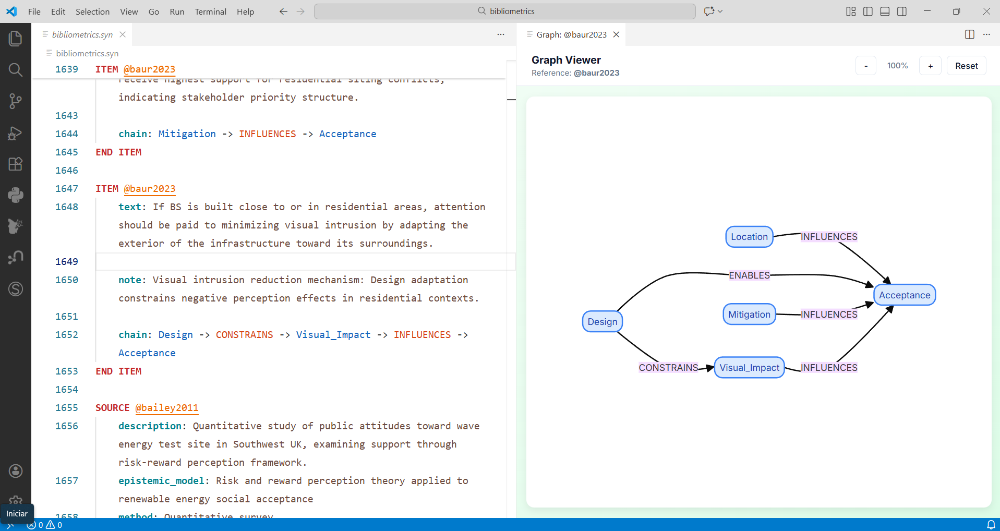
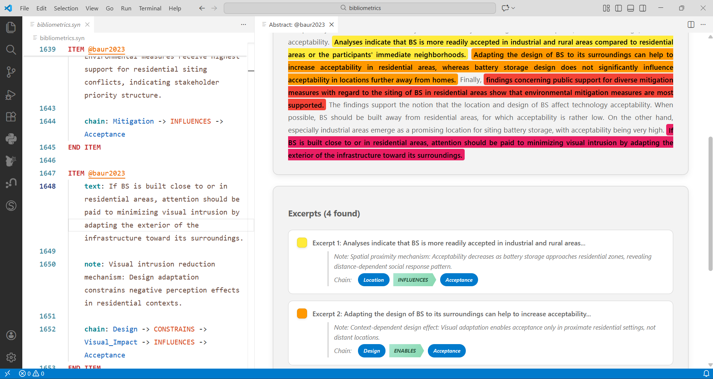
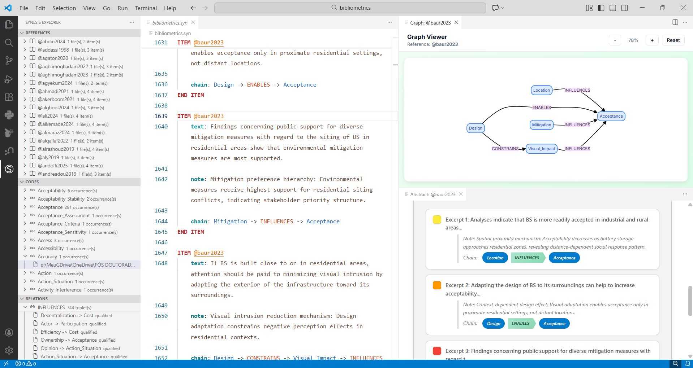

# Guia rápido: a extensão Synesis para VS Code

**Objetivo:** ajudar você a instalar e usar a extensão **Synesis** (versão 0.17) para escrever e navegar arquivos Synesis (`.synp`, `.synt`, `.syn`, `.syno`, `.synr`). Esta extensão também é conhecida como Synesis Explorer.

A interface da extensão está em **inglês**.

---

## O que a extensão faz

- Valida os arquivos enquanto você digita e completa campos, códigos e relações
- Mostra referências, códigos, relações, ontologia e campos do template em painéis laterais
- Abre grafos de relações e o resumo (abstract) das referências
- Codifica um trecho selecionado com o `synesis-coder`
- Conversa com um banco de grafos do projeto no chat do VS Code



---

## Requisitos

- VS Code
- Python 3.10 ou superior
- O compilador e o servidor de linguagem, que fazem a análise (a extensão é a interface):

```bash
pip install synesis synesis-lsp
```

---

## Instalação

1. No VS Code, abra a aba de extensões (`Ctrl+Shift+X`)
2. Procure por **Synesis** (publicador `synesis-lang`)
3. Clique em **Install**

Para instalar a partir de um arquivo `.vsix`, use o menu `...` da aba de extensões e **Install from VSIX...**.



---

## Primeiro projeto

Numa pasta vazia:

```bash
synesis init
```

Abra a pasta no VS Code. O ícone do Synesis aparece na barra de atividades e os painéis se preenchem.



---

## Os painéis



| Painel | Mostra |
|---|---|
| **References** | as fontes (`SOURCE`), com os itens dentro |
| **Codes** | os códigos e cada ocorrência |
| **Relations** | as cadeias (`CHAIN`), agrupadas por fonte |
| **Ontology Topics** | os tópicos da ontologia; com `ROLE HIERARCHY`, a árvore de conceitos |
| **Ontology (Annotations)** | onde os conceitos são usados nos `.syn` |
| **Template Fields** | os campos do template, por escopo |

Alguns painéis aparecem conforme o tipo de arquivo aberto. Clique numa entrada para ir à linha exata. Cada painel tem botões de atualizar e filtrar.







Na árvore da ontologia, o menu de contexto de um conceito oferece **Subtree Evidence**: os itens do conceito e de todos os descendentes.

---

## Grafos e resumos

| Ação | Atalho (Windows/Linux) | Mac |
|---|---|---|
| Grafo de relações por fonte | `Ctrl+Alt+G` | `Cmd+Shift+G` |
| Grafo por arquivo | `Ctrl+Alt+F` | `Cmd+Shift+F` |
| Grafo por item | `Ctrl+Alt+I` | `Cmd+Alt+I` |
| Resumo (abstract) da referência | `Ctrl+Shift+A` | `Cmd+Shift+A` |
| Codificar a seleção com IA | `Ctrl+Shift+I` | `Cmd+Shift+I` |





---

## Edição

- **Diagnósticos em tempo real:** erros e avisos sublinhados e no painel *Problems* (`Ctrl+Shift+M`)
- **Autocompletar:** campos, códigos, relações, valores de listas, papéis depois de `ROLE` e propriedades de `EXPORT`
- **Hover:** definição do campo; em conceitos, pais, filhos e quantidade de evidências
- **Ir à definição** (`F12`) e **renomear** (`F2`) códigos e referências em todo o projeto
- **Snippets:** digite `field-chain`, `field-scale`, `field-ordered`… ou `SOURCE`, `ITEM`, `ONTOLOGY` e pressione `Tab`; os blocos de anotação trazem os campos obrigatórios do **seu** template
- **Temas:** *Synesis Dark* e *Synesis Light*

---

## Codificar com IA

Instale o `synesis-coder` (`pip install synesis-coder`), configure a chave no `.env` do projeto, selecione um trecho num `.syn` e use **Synesis: Code Selection** (`Ctrl+Shift+I`). Veja [Codificação com IA](../howto/synesis_coder.qmd).

---

## Conversar com o grafo

A extensão registra um participante de chat que consulta um banco ArcadeDB do projeto, criado pelo [`synesis-graph`](../reference/synesis_graph.qmd). Os comandos **Synesis: Settings** (conexões e provedores), **Synesis: Select Chat Graph Database** e **Synesis: Show Turn Evidence and Queries** configuram o chat e mostram a trilha de auditoria de cada resposta. As chaves ficam no armazenamento seguro do VS Code.

---

## Configurações

Em *Settings*, procure por "Synesis" (prefixo `synesisExplorer.`):

| Configuração | Para quê |
|---|---|
| `lsp.pythonPath` | caminho do executável `synesis-lsp`, se não estiver no `PATH` |
| `lsp.enabled` | liga ou desliga o servidor |
| `diagnostics.enabled` | mostra os sublinhados |
| `diagnostics.checkCodes` | avisa cada código ausente da ontologia (desligado por padrão: um resumo no `.synp`) |
| `inlayHints.enabled` | mostra "(Autor, Ano)" depois das referências |
| `semanticHighlighting.enabled` | realce baseado na árvore sintática |
| `completion.autoImportCodes` | oferece os códigos da ontologia ao completar |
| `coder.path` | caminho do `synesis-coder` |

---

## Problemas comuns

**Os painéis estão vazios.** Confira se a pasta aberta tem um arquivo `.synp` e se o `synesis-lsp` está instalado (veja o canal de saída *Synesis LSP*).

**Um painel não aparece.** Vários dependem do tipo de arquivo aberto: abra um `.syn` ou `.syno`.

**"Failed to start Synesis LSP".** Informe em `synesisExplorer.lsp.pythonPath` o caminho completo do executável.

**Relações não aparecem.** Verifique se o template tem um campo `TYPE CHAIN` e se há cadeias anotadas.

---

## Pronto para usar

Com isso, você já consegue escrever, validar, navegar e visualizar seus dados Synesis no VS Code.


