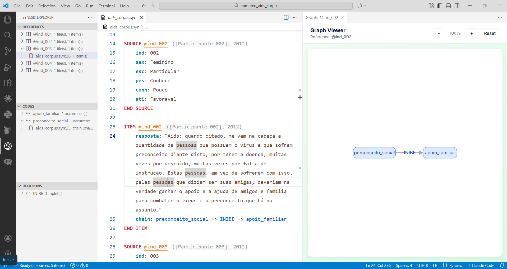

# Synesis para Usuários do IRaMuTeQ

Este tutorial é destinado a pesquisadores que já conhecem o IRaMuTeQ e querem entender como a linguagem Synesis pode complementar — e ampliar — seu fluxo de análise qualitativa.

**Você vai aprender a:**

- Estruturar um corpus diretamente em Synesis, desde a coleta
- Criar um template tipado com validação automática
- Gerar o corpus no formato IRaMuTeQ a partir do projeto Synesis
- Acrescentar camadas de anotação que alimentam análises além do IRaMuTeQ

**Pré-requisito:** familiaridade com o formato de corpus do IRaMuTeQ (linhas `****`, variáveis e modalidades).

---

## O Problema: o Corpus IRaMuTeQ é um Destino, não uma Fonte

O fluxo tradicional com o IRaMuTeQ começa fora do software: o pesquisador prepara um arquivo `.txt` com as linhas `****`, geralmente num editor de texto, e o insere para análise. Não há validação do desenho da pesquisa: uma modalidade inexistente ou um campo faltante produz ruído silencioso nos resultados.

Para corpus pequenos e pesquisadores solo, isso é administrável. Para centenas de textos, vários codificadores ou fases de coleta distintas, torna-se um risco metodológico real.

O Synesis inverte o fluxo: o corpus é mantido em Synesis desde o início, validado pelo compilador a cada edição, e convertido para IRaMuTeQ sob demanda. O `.txt` do IRaMuTeQ passa a ser um **artefato derivado**, gerado a partir da fonte canônica.

---

## Parte 1 — O Corpus IRaMuTeQ e sua Estrutura

O IRaMuTeQ organiza o corpus com **linhas de comando** que precedem cada texto. Cada linha começa com `****` e lista variáveis no formato `*nome_valor`.

### Exemplo: corpus "aids"

Este corpus reúne respostas à questão *"O que você pensa a respeito da Aids?"*, coletadas de estudantes do ensino médio (Antunes, 2012). É um dos exemplos canônicos para a Classificação Hierárquica Descendente (CHD) com respostas curtas.

:::{.callout-note}
## Tutorial Iramuteq
Os exemplos deste tutorial foram extraídos do Manual de uso do software Iramuteq [@camargo2021].

O [repositório de estudos de caso](https://github.com/synesis-lang/case-studies/tree/main/Sociology/iramuteq_aids_corpus) contém o projeto pronto para uso.
:::

| Variável | Descrição | Modalidades no IRaMuTeQ |
|----------|-----------|-------------|
| `*ind`   | Indivíduo participante | 001 a 312 |
| `*sex`   | Sexo | 1 = masculino, 2 = feminino |
| `*esc`   | Tipo de escola | 1 = pública, 2 = particular |
| `*pes`   | Conhece soropositivo | 1 = conhece, 2 = não conhece |
| `*conh`  | Conhecimento sobre transmissão | 1 = bom, 2 = pouco |
| `*ati`   | Atitude frente ao soropositivo | 1 = favorável, 2 = neutra, 3 = desfavorável |

```text
**** *ind_001 *sex_1 *esc_2 *pes_2 *conh_1 *ati_3
A aids é um vírus que tem que tomar muito cuidado. É importante conhecer
seu parceiro na hora de realizar atos sexuais. O vírus pode ser transmitido
por causa de um ato irresponsável, transar sem o uso de um preservativo,
ou através de um estupro.
**** *ind_002 *sex_2 *esc_2 *pes_1 *conh_2 *ati_1
Aids: quando citado, me vem na cabeça a quantidade de pessoas que possuem
o vírus e que sofrem preconceito diante disto, por terem a doença.
```

Cada bloco `****` é uma **unidade de contexto inicial (UCI)**: os valores depois de `****` são os metadados do respondente, e o texto que segue é o conteúdo analisado.

---

## Parte 2 — Criando o Template Synesis

O template (`.synt`) declara os campos, seus tipos e suas regras. Em Synesis, as modalidades recebem nomes legíveis; o código numérico do IRaMuTeQ é aplicado só na exportação.

<!-- file: aids_corpus.synt -->
```synesis
TEMPLATE aids_corpus version: "1.0"

# ============================================
# CAMPOS DE SOURCE
# ============================================

SOURCE FIELDS
    REQUIRED ind, sex, esc, pes, conh, ati
END SOURCE FIELDS

FIELD ind TYPE TEXT
    SCOPE SOURCE
    DESCRIPTION Identificador único do participante
END FIELD

FIELD sex TYPE ENUMERATED
    SCOPE SOURCE
    DESCRIPTION Sexo do participante
    VALUES
        Masculino: Sexo masculino
        Feminino: Sexo feminino
    END VALUES
END FIELD

FIELD esc TYPE ENUMERATED
    SCOPE SOURCE
    DESCRIPTION Tipo de escola frequentada
    VALUES
        Publica: Escola da rede pública
        Particular: Escola da rede particular
    END VALUES
END FIELD

FIELD pes TYPE ENUMERATED
    SCOPE SOURCE
    DESCRIPTION Conhece pessoa soropositiva
    VALUES
        Conhece: Conhece ao menos uma pessoa soropositiva
        Nao_conhece: Não conhece pessoa soropositiva
    END VALUES
END FIELD

FIELD conh TYPE ENUMERATED
    SCOPE SOURCE
    DESCRIPTION Conhecimento sobre transmissão do HIV
    VALUES
        Bom: Bom conhecimento
        Pouco: Pouco conhecimento
    END VALUES
END FIELD

FIELD ati TYPE ENUMERATED
    SCOPE SOURCE
    DESCRIPTION Atitude frente ao soropositivo
    VALUES
        Favoravel: Atitude favorável
        Neutra: Atitude neutra
        Desfavoravel: Atitude desfavorável
    END VALUES
END FIELD

# ============================================
# CAMPOS DE ITEM
# ============================================

ITEM FIELDS
    REQUIRED resposta
    OPTIONAL chain
END ITEM FIELDS

FIELD resposta TYPE QUOTATION
    SCOPE ITEM
    DESCRIPTION Resposta à questão aberta sobre a Aids
    GUIDELINES
        Copie a resposta inteira, sem corrigir a grafia.
    END GUIDELINES
END FIELD

FIELD chain TYPE CHAIN
    SCOPE ITEM
    ARITY >= 2
    DESCRIPTION Relação entre ideias afirmada na resposta
    RELATIONS
        INIBE: um conceito reduz ou bloqueia outro
        PROMOVE: um conceito favorece ou amplia outro
        ASSOCIA: associação entre conceitos
    END RELATIONS
END FIELD

# ============================================
# CAMPOS DE ONTOLOGY
# ============================================

ONTOLOGY FIELDS
    REQUIRED descricao
    OPTIONAL grupo
END ONTOLOGY FIELDS

FIELD descricao TYPE TEXT
    SCOPE ONTOLOGY
    DESCRIPTION Definição do conceito no contexto das representações da Aids
END FIELD

FIELD grupo TYPE TOPIC
    SCOPE ONTOLOGY
    DESCRIPTION Agrupamento temático do conceito
END FIELD
```

**Por que isso importa:** uma tentativa de registrar `ati: Neutro` ou `sex: Outro` é rejeitada pelo compilador antes que o dado chegue ao IRaMuTeQ, com a sugestão do valor mais próximo.

---

## Parte 3 — Estruturando o Corpus em Synesis

Cada respondente é um par `SOURCE` + `ITEM`. Arquivo `aids_corpus.syn`:

<!-- file: aids_corpus.syn -->
```synesis
SOURCE @ind_001
    ind: 001
    sex: Masculino
    esc: Particular
    pes: Nao_conhece
    conh: Bom
    ati: Desfavoravel
END SOURCE

ITEM @ind_001
    resposta: "A aids é um vírus que tem que tomar muito cuidado. É importante conhecer seu parceiro na hora de realizar atos sexuais."
END ITEM

SOURCE @ind_002
    ind: 002
    sex: Feminino
    esc: Particular
    pes: Conhece
    conh: Pouco
    ati: Favoravel
END SOURCE

ITEM @ind_002
    resposta: "Aids: quando citado, me vem na cabeça a quantidade de pessoas que possuem o vírus e que sofrem preconceito diante disto, por terem a doença."
    chain: preconceito_social -> INIBE -> apoio_familiar
END ITEM

SOURCE @ind_003
    ind: 003
    sex: Feminino
    esc: Particular
    pes: Nao_conhece
    conh: Pouco
    ati: Desfavoravel
END SOURCE

ITEM @ind_003
    resposta: "Eu penso que é uma questão complicada, porque a pessoa fica mal e tem que viver de remédios e tem medo de passar pra outra."
END ITEM
```

A ontologia (`aids_corpus.syno`) define os conceitos usados nas cadeias:

<!-- file: aids_corpus.syno -->
```synesis
ONTOLOGY preconceito_social
    descricao: Rejeição ou discriminação dirigida a pessoas soropositivas
    grupo: dimensao_social
END ONTOLOGY

ONTOLOGY apoio_familiar
    descricao: Suporte de familiares e amigos a quem convive com HIV/Aids
    grupo: dimensao_social
END ONTOLOGY
```

A bibliografia (`aids_corpus.bib`) tem uma entrada por respondente, com chave neutra:

<!-- file: aids_corpus.bib -->
```bibtex
@misc{ind_001, author = {Participante 001}, title = {Resposta 001}, year = {2012}}
@misc{ind_002, author = {Participante 002}, title = {Resposta 002}, year = {2012}}
@misc{ind_003, author = {Participante 003}, title = {Resposta 003}, year = {2012}}
```

E o projeto (`aids_corpus.synp`):

<!-- file: aids_corpus.synp -->
```synesis
PROJECT aids_corpus
    TEMPLATE "aids_corpus.synt"
    INCLUDE BIBLIOGRAPHY "aids_corpus.bib"
    INCLUDE ANNOTATIONS "aids_corpus.syn"
    INCLUDE ONTOLOGY "aids_corpus.syno"
END PROJECT
```



---

## Parte 4 — Gerando o corpus do IRaMuTeQ

O compilador **não tem** um exportador IRaMuTeQ. A conversão é um passo curto sobre o JSON compilado. Primeiro:

```bash
synesis compile aids_corpus.synp --json corpus.json
```

Depois, salve este script como `para_iramuteq.py`:

<!-- script: para_iramuteq.py -->
```python
import json
import re

# Código numérico que o IRaMuTeQ receberá para cada modalidade
CODIGOS = {
    "sex": {"Masculino": "1", "Feminino": "2"},
    "esc": {"Publica": "1", "Particular": "2"},
    "pes": {"Conhece": "1", "Nao_conhece": "2"},
    "conh": {"Bom": "1", "Pouco": "2"},
    "ati": {"Favoravel": "1", "Neutra": "2", "Desfavoravel": "3"},
}
VARIAVEIS = ["ind", "sex", "esc", "pes", "conh", "ati"]
CAMPO_TEXTO = "resposta"

with open("corpus.json", encoding="utf-8") as f:
    dados = json.load(f)

linhas = []
for item in dados["corpus"]:
    chave = item["source_ref"].lstrip("@")
    fonte = dados["bibliography"][chave]      # inclui os campos de SOURCE
    marcas = []
    for var in VARIAVEIS:
        valor = str(fonte[var])
        if var == "ind":
            valor = valor.zfill(3)            # 001 é lido como número 1
        marcas.append(f"*{var}_{CODIGOS.get(var, {}).get(valor, valor)}")
    texto = item["data"][CAMPO_TEXTO].strip().strip('"')
    texto = re.sub(r"[*$%\"]", " ", texto)    # caracteres que o IRaMuTeQ reserva
    linhas.append("**** " + " ".join(marcas))
    linhas.append(texto)

with open("aids_iramuteq.txt", "w", encoding="utf-8") as f:
    f.write("\n".join(linhas) + "\n")

print(f"{len(dados['corpus'])} textos escritos em aids_iramuteq.txt")
```

```bash
python para_iramuteq.py
```

O arquivo gerado pode ser aberto no IRaMuTeQ (codificação UTF-8):

```text
**** *ind_001 *sex_1 *esc_2 *pes_2 *conh_1 *ati_3
A aids é um vírus que tem que tomar muito cuidado. É importante conhecer seu parceiro na hora de realizar atos sexuais.
**** *ind_002 *sex_2 *esc_2 *pes_1 *conh_2 *ati_1
Aids: quando citado, me vem na cabeça a quantidade de pessoas que possuem o vírus e que sofrem preconceito diante disto, por terem a doença.
```

| Synesis | IRaMuTeQ |
|---------|----------|
| Bloco `SOURCE` | variáveis da linha `****` |
| Campo `sex: Masculino` | `*sex_1` |
| Campo `ati: Desfavoravel` | `*ati_3` |
| Campo `QUOTATION` do `ITEM` | texto que segue a linha `****` |

Adapte `CODIGOS`, `VARIAVEIS` e `CAMPO_TEXTO` ao seu template. Daí em diante, CHD, similitude, AFC e nuvem de palavras seguem como de costume, com a garantia de que o corpus foi validado antes.

---

## Parte 5 — Synesis como Hub de Análise

A principal vantagem de manter o corpus em Synesis é que a mesma fonte alimenta vários destinos:

```text
Corpus Synesis (.synp + .bib + .syn + .synt + .syno)
        │
        ├──► o compilador valida contra o template
        │       └── erros relatados antes da análise
        │
        ├──► JSON ──► script ──► IRaMuTeQ (.txt)
        │                         └── CHD, similitude, AFC, nuvem
        │
        ├──► CSV / Excel ──► planilhas, R, pandas
        │
        ├──► synesis.load() no Jupyter
        │         ├── sources     → variáveis do SOURCE
        │         ├── items       → textos e campos do ITEM
        │         ├── ontologies  → conceitos
        │         └── chains      → relações
        │
        ├──► synesis-graph ──► grafo (HTML, Neo4j, ArcadeDB)
        │
        └──► codificação adicional no próprio corpus
                ├── CODE, CHAIN   (categorias e relações)
                ├── MEMO          (notas analíticas)
                └── SCALE         (escores por item)
```

### Adicionando anotações ao corpus

Depois de rodar a CHD e identificar classes temáticas, volte ao corpus e enriqueça-o. Por exemplo, acrescente um campo `ENUMERATED` ao template para a classe da CHD, ou registre uma relação:

```synesis
ITEM @ind_002
    resposta: "Quando citado, me vem na cabeça a quantidade de pessoas que sofrem preconceito."
    chain: preconceito_social -> INIBE -> apoio_familiar
END ITEM
```

Essas anotações não mudam o `.txt` do IRaMuTeQ, mas ficam disponíveis para o grafo, para as tabelas e para uma segunda rodada no IRaMuTeQ com variáveis derivadas da codificação.

### Acesso programático

```python
import synesis

projeto = synesis.SynesisCompiler("aids_corpus.synp").compile()
projeto.to_csv("tabelas/")      # sources.csv, items.csv, chains.csv...
```

Para trabalhar inteiramente em memória, com DataFrames, use [`synesis.load`](../reference/synesis_load.qmd).

---

## Parte 6 — Synesis como Camada de Governança

Para pesquisadores solo com corpus pequenos, o IRaMuTeQ sozinho é suficiente. O Synesis faz diferença em três cenários:

**Corpus volumosos.** Com centenas de participantes, o erro de digitação em variáveis é provável. O compilador o captura antes da análise.

**Trabalho em equipe.** O template funciona como contrato: campos, valores permitidos e relações estão num único arquivo versionável. Divergências aparecem na compilação.

**Pesquisa longitudinal.** Quando o corpus cresce, o template mantém a integridade entre versões, e as decisões conceituais podem ser documentadas no `.syno`:

```synesis
# DECISÃO 2026-03-01: separamos "preconceito" em dois conceitos após
# distinguir preconceito declarado de comportamento relatado.

ONTOLOGY preconceito_declarado
    descricao: Expressão verbal de atitude discriminatória
    grupo: dimensao_social
END ONTOLOGY

ONTOLOGY preconceito_comportamental
    descricao: Ação discriminatória relatada pelo participante
    grupo: dimensao_social
END ONTOLOGY
```

---

## Resumo

| Aspecto | IRaMuTeQ | Synesis + IRaMuTeQ |
|---------|----------|--------------------|
| Validação de corpus | Formato do arquivo | Campos e modalidades do desenho |
| Fonte canônica | Arquivo `.txt` | Corpus `.syn` + template `.synt` |
| Destinos | Resultados internos | IRaMuTeQ (via script), CSV, JSON, Excel, grafos |
| Anotação interpretativa | Não suportada | CODE, CHAIN, MEMO, SCALE |
| Trabalho em equipe | Manual | Template como contrato |
| Acesso programático | Não disponível | API Python |

O IRaMuTeQ continua sendo a ferramenta indicada para CHD, similitude e AFC. O Synesis não substitui essas análises: ele governa o corpus que as alimenta e o abre para outras.

---

## Próximos Passos

- [Como Definir uma Ontologia](../howto/definir_ontologia.qmd)
- [Como Criar Chains](../howto/criar_chains.qmd)
- [Referência da Linguagem](../reference/guia_referencia.qmd)

---

**Ficou com dúvidas?** Consulte [GitHub Discussions](https://github.com/synesis-lang/synesis/discussions) ou abra uma issue no repositório.

---

## Referências
